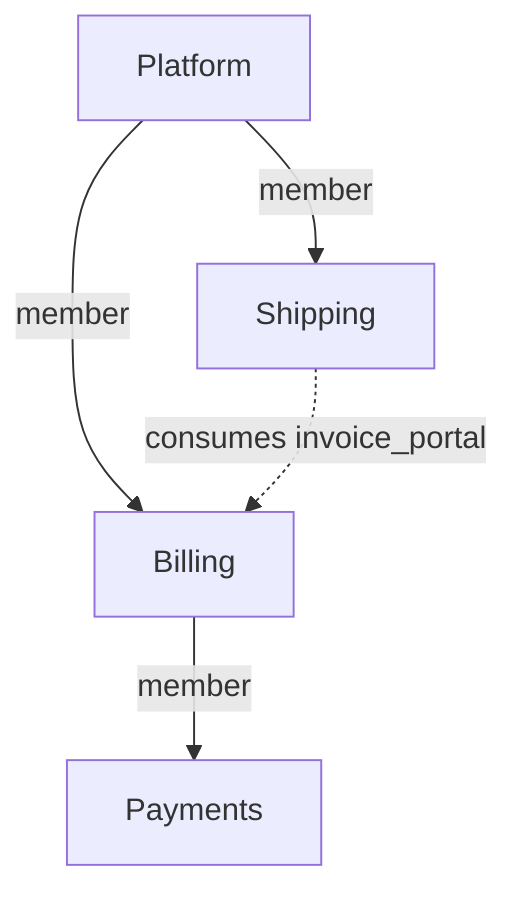

_Section copied verbatim from [`responses/chatgpt-6-astra_chat.md`](../../../responses/chatgpt-6-astra_chat.md), the generated file of the ChatGPT 6 Astra answer (answered `problem.md` r2 · no repository access). The chat text of the same answer, [`responses/chatgpt-6-astra_chat_response.md`](../../../responses/chatgpt-6-astra_chat_response.md), was compared with it sentence by sentence: the two are one answer in two renderings, the chat text a terser paraphrase, and the generated file the fuller of the two in every section — so it is the base here. Whatever the chat text alone says is quoted under "Chat-text form" at the end._
_This file holds the source's title and preamble, its model section, its issue-00 section, and its worked example, interactions, what-not-to-do, prior art and questions, per the folder convention._

# Wairon: compose projects without changing their meaning

Based on the supplied problem statement, Revision 2, dated 12 September 2026. This is a design proposal without repository inspection. All schemas, commands, and diagnostic names below are proposed. YAML excerpts omit unrelated required fields. The proof sections specify acceptance tests; they do not report executed implementation tests.

## Model in one page

**A chained subsystem should become a project membership relation, outside the L0–L5 hierarchy.** Keep one project model and two explicit relations: **membership** says which projects constitute a system; **consumption** says which published contracts a project uses. These relations are independent. Membership permits composition analysis; consumption permits architectural references. Neither grants editing or approval authority.

Each project owns its L0, L1 subsystems, remaining specs, configuration, approval, and generated files. A parent groups project architectures without merging their records or demoting a child's L0 into L1. Billing and Shipping remain project boundaries even when Platform displays their communication as internal to its composition. Looking inside Billing does not authorize calling its private components.

Identity is `(projectId, localSpecId)`. Both identifiers survive moves and display-name changes. Mount aliases and filesystem paths are locators. References use local ids or consumer-owned dependency aliases, such as `dep:billing/invoice_portal`. The alias resolves through Shipping's own manifest to Billing's stable project identity.

Validation answers two explicit questions:

1. **Project validity:** does this project's snapshot satisfy its declared policies, approval state, and locked contract inputs?
2. **Composition validity:** do the selected project snapshots satisfy their own gates, the composition's additional policies, and each other's contract requirements?

A composition never replaces project findings. Every result identifies its input and policy digests. A detached Shipping can validly target Billing contract C1 while a proposed Platform containing incompatible C2 fails integration. Those are different propositions. The same proposition must have the same result from either scope.

The parent governs admission and system integration. Shared internal doctrine is an explicit, pinned policy dependency that children adopt and the parent requires. A child can decline a new requirement and remain a valid independent project; the parent can decline that child version. If several teams need one unconditional approval and policy authority, keep their subsystems in one project. Directory partitioning alone is insufficient reason to manufacture another project.

| Commitment | Decision and consequence |
|---|---|
| R1 — One verdict | **Keep its explicit-difference allowance.** Equality is for the same edge, snapshots, policy, and question; never an unqualified green badge. |
| R2 — Independent child | **Keep.** Local inputs suffice for its own gate; independence does not promise compatibility with every parent. |
| R3 — First-class parent | **Weaken ownership, preserve capability.** The parent inspects, integrates, approves a composition, and delegates across authorized members; it cannot silently replace their governance. |
| R4 — Write ownership | **Keep.** Cross-project work names each write target explicitly. |
| R5 — Round-trips | **Keep.** Parent-mediated editing invokes the same owner-scoped operation. |
| R6 — Confinement | **Refine.** A child accesses its own data and explicitly granted contract/context artifacts. Family visibility requires member grants; ancestry is not authorization. |
| R7 — No location softening | **Keep.** No ancestor discovery or disk-dependent evidence substitution. |
| R8 — Layouts | **Keep.** Source location is separate from project identity. |
| R9 — Nesting | **Keep finite arbitrary depth.** Membership is acyclic; repeated membership can form a DAG. |
| R10 — Proportional cost | **Keep.** Validate local ownership and consumed inputs; evaluate broader rules only when requested. |
| R11 — Predictability | **Keep for architecture.** Manifests, input locks, and explicit contexts determine resolution and judgement. Hosted authorization remains an additional server responsibility. |

---

## 00 — The model: what a chained subsystem is

**Diagnosis.** Storage containment is being used as architecture containment, identity scope, policy authority, and an authorization boundary. These are different relationships. A `kind` switch alone would still leave their coupling unexplained.

**Options.**

- **One recursively flattened system:** simple authority, but genuinely independent child configuration and approval disappear; sacrifices R2 to maximize R3.
- **Declared `federated` and `dependency` mounts:** makes the principal tradeoff visible, but multiplies behavior across nesting and kind changes. R9 and R11 need a composition table for mixed kinds.
- **One project model, membership plus consumption:** preserves R2 and R9; limits R3's unilateral authority. Recommended.

**Recommendation.** Move composition out of L1:

```yaml
projectId: syw.platform
members:
  billing:
    project: syw.billing
    source: {path: services/billing}
```

This does not itself create a dependency or export. An unrelated project can import Billing's contracts without adding Billing as a member. Membership can expose the full architecture to authorized reviewers; dependencies expose only their declared contracts. A child's L0 stays L0, shown inside a project grouping in the parent's view.

**Migration.** Introduce a versioned schema and convert `projectPath` into membership. Generate separate imports for actual cross-project references. Existing projects continue in legacy mode; adopting the new schema requires updated clients. Do not label legacy and new results equivalent where governance changes.

**Proof.** Loading Billing alone or through two different parents yields the same owned graph. Dependency-only access cannot resolve a private Billing target. Membership cycles fail explicitly; adding another nesting level changes neither identities nor validation rules.

---

## Worked example — Platform, Billing, Payments, Shipping

Assume the invoice method is `create_invoice(shipment_id: string) -> InvoiceId`, and all omitted L0 content, implementations, local narratives, and required type definitions are complete and conforming. `P1`, `C1`, and `F1` stand for actual content digests in real files. Pinned artifacts are available locally.

Each project declares only relationships it owns; children need no parent pointer:

```yaml
# platform/.wai/project.yaml
projectId: syw.platform
policy:
  profiles: ["syw.service@sha256:P1"]
members:
  billing:
    project: syw.billing
    source: {path: services/billing}
  shipping:
    project: syw.shipping
    source: {path: services/shipping}
composition:
  requirePolicies:
    - {profile: "syw.service@sha256:P1", scope: descendants}
---
# platform/services/billing/.wai/project.yaml
projectId: syw.billing
policy:
  profiles: ["syw.service@sha256:P1"]
members:
  payments:
    project: syw.payments
    source: {path: payments}
---
# platform/services/billing/payments/.wai/project.yaml
projectId: syw.payments
policy:
  profiles: ["syw.service@sha256:P1"]
---
# platform/services/shipping/.wai/project.yaml
projectId: syw.shipping
policy:
  profiles: ["syw.service@sha256:P1"]
imports:
  billing:
    project: syw.billing
    contracts: [invoice_portal]
```

The existing L0 visions remain owned by their respective projects. The membership view is:



The actual L1 declarations remain local:

| Owner | L1 id | Publication and trust |
|---|---|---|
| Platform | `core` | `publicInterfaces: [core_portal]` |
| Billing | `billing` | `publicInterfaces: [invoice_portal]` |
| Payments | `payments` | No export is needed for this example. |
| Shipping | `dispatch` | `trustedLinks: ["dep:billing"]`; no export is needed. |

Here the proposed `trustedLinks` alias permits dispatch's outgoing use of the contracts declared under that import. Billing's publication permits architectural consumption by declared importers; it is not a grant of hosted read access. A restricted consumer audience, when declared, is checked separately as part of the provider contract.

Billing declares the provider:

```yaml
# L2
id: invoice_portal
subsystem: billing
stereotype: Portal
interface: invoice_contract
---
# L3
id: invoice_contract
component: invoice_portal
methods:
  - name: create_invoice
    parameters: {shipment_id: string}
    returns: InvoiceId
```

Shipping declares the consumer and call:

```yaml
# L2
id: dispatch_adapter
subsystem: dispatch
stereotype: Adapter
dependsOn: ["dep:billing/invoice_portal"]
---
# L5 excerpt
component: dispatch_adapter
method: dispatch
steps:
  - number: 1
    call:
      target: "dep:billing/invoice_portal#create_invoice"
      args: {shipment_id: shipment.id}
```

Shipping's input lock is C1 as shown in issue 05. The canonical edge is always `syw.shipping/dispatch_adapter → syw.billing/invoice_portal#create_invoice`. Platform's `shipping` and `billing` aliases do not participate in its meaning.

| View | What is actually judged |
|---|---|
| **Shipping, own gate** | Dispatch is an Adapter; the dependency and outgoing trust are declared; C1 publishes the target; the method and arguments match; Shipping's code matches its specs. No parent is needed. |
| **Platform, composition F1** | Includes that exact Shipping assessment, Billing's own assessment, all other member assessments, P1 requirements, and verification that F1's selected Billing provides C1's promised interface and access. The edge is inside Platform's composition and still crosses a project boundary. |
| **Billing, own gate** | Validates its publication and implementation. It has no Shipping call site to judge. Output says inbound consumers are not assessed, rather than claiming the edge passed. |
| **Billing or Shipping, supplied with F1 context** | Judges the same integration obligation as Platform using the authorized context artifact. The result retains the original edge owner, policy issuers, and snapshot basis. |

Capture the family inputs explicitly:

```bash
# At Platform; writes the requested context artifact in Platform only
wairon context capture --family --inputs working --out .wai/contexts/platform-F1.yaml
wairon validate --context .wai/contexts/platform-F1.yaml --ci

# At Shipping, after an explicitly shared projection is available to it
wairon context import shipping-F1.yaml --name platform-F1
wairon validate --context .wai/contexts/platform-F1.yaml --ci
```

A projection supplies the required provider contracts, versioned policy, relevant consumer obligations, and evidence basis. It grants no sibling filesystem access. A predicate requiring omitted global facts needs a matching trusted composition attestation or is incomplete; a projection cannot masquerade as a whole-family check. Billing can consume an analogous projection to inspect inbound obligations.

Approve from the leaves upward:

| Approval | Promise |
|---|---|
| Payments own approval | Its owned architecture, policy, and locked inputs are accepted. |
| Billing composition approval | Billing's own subject, its exact approved Payments composition, and Billing's integration obligations are accepted. |
| Shipping own approval | Its architecture and use of expected contract C1 are accepted. It does not approve Billing's implementation or promise Billing will keep deploying C1. |
| Platform composition approval | Platform's own subject, approved Billing including Payments, approved Shipping, selected provider bindings, and Platform integration obligations are accepted for F1. |

Approvers need authority for their explicit targets. A platform-team member may also approve Billing if granted that role; invoking Platform's approval does not imply it.

**Now Billing renames `create_invoice` to `issue_invoice`, removing the old method.** Assume Billing updates its own implementation and narratives consistently. Its new surface is C2.

| Check | Consequence |
|---|---|
| Billing's own structural validation | Can pass; Billing's approval is drifted. A configured release-compatibility check against C1 also reports a breaking removal. Unknown consumers are not fabricated. |
| Shipping's own validation against C1 | Still passes on either checkout layout. Its unchanged approval remains an approval of C1-based work. |
| Platform working-family validation, or F2 capturing C2 | Fails `CONTRACT_METHOD_REMOVED`: Shipping requires C1's `create_invoice`, while selected Billing C2 omits it. Approval drift is a separate finding. |
| Shipping/Billing integration assessment with F2 | Reports the same integration failure as Platform. |
| Historical F1 assessment | Remains valid for the old snapshots. It says nothing about deploying C2. |

Payments' approval does not change. Billing's own and composition subjects change; Platform must not claim its F1 approval covers F2. Billing can publish an independently approved breaking version without forcing Shipping to adopt it, but that version cannot pass the existing Platform composition.

Either Billing retains `create_invoice` as a working compatibility method, or Shipping explicitly updates its import, call, implementation, and approval to C2 before Platform approves the new composition. Keeping the old Billing revision selected is also valid. No command silently rewrites Shipping or refreshes its pins. Renaming only an implementation symbol while preserving the L3/wire contract would instead be a local implementation change.

## Interactions

- **Identity, ownership, and migrations reinforce each other.** Alias and path changes become small. Moving ownership between projects remains a real API/identity migration; stable ids cannot make it consequence-free.
- **Governance and reproducibility reinforce each other.** Pinned policy imports make the child's rules available offline. A parent's newer requirement becomes an explicit admission failure until adopted. Conflicting policy predicates remain conflicts even if one severity is higher.
- **Approval requires the same snapshots as validation.** Canonical identities make recursive subjects possible; owner attribution makes settledness consistent. An approval digest alone is insufficient without matching actual content or trusted evidence for those exact snapshots.
- **Confinement limits aggregate claims.** A parent without a necessary member grant cannot claim complete family validation. A child receives authorized artifacts, not an implicit route into sibling repositories. Briefs, archives, validation, and generation must share the same boundary enforcement.
- **Offline operation limits freshness claims.** A detached clone cannot discover a later revocation. Historical contract validity and current deployment authorization are different checks. If immediate revocation matters, an explicit deployment gate must obtain current revocation/provider evidence and fail closed when its required freshness cannot be established.
- **Cost follows the obligation.** Contract and policy digests permit local caching and focused rechecks. Global cycle or system-wide policy rules may need a larger graph; R10 should not justify omitting facts required by a rule.

Issues 00/01/02/10 share the identity-and-ownership root cause; 03/04/05/07 share the missing assessment-basis root cause; 06/08/09 expose both through user-facing operations. I kept their headings separate so implementation work can still track the statement's issue ids.

## What I would not do

- Add per-tool `federated`, `independent`, `inherit`, `opaque`, and `livePreferred` switches. Independent relationship axes are clearer than a behavioral matrix of project kinds.
- Fix root-sensitive ids with more prefix heuristics, tail matching, or silent `super::` clamping.
- Treat a newer contract as automatically required, or an old valid pin as proof of a currently compatible deployment.
- Merge arbitrary findings by code, select whichever result is kinder, or let one authority's suppression erase another's obligation.
- Make approval initialize projects, generate child files, update dependencies, or approve descendants implicitly.
- Equate Git commits with human approval, promise atomic independent-repository rewrites, or assume all external consumers are discoverable.
- Add a global registry, mandatory signing infrastructure, or deployment-instance model before the stated requirements need them. Stable declared identity and explicit source provenance suffice for the initial design.

## Prior art — useful mechanisms and their limits

The applications and limitations below are architectural comparisons, not claims that these tools already implement the proposed wairon model.

| System | What genuinely applies | Where the analogy breaks |
|---|---|---|
| **[Bazel external repositories](https://bazel.build/external/overview)** | Canonical versus apparent repository names illustrate stable resolution through consumer-local aliases. Declared dependencies and on-demand fetching help R10. | Bazel's canonical names are canonical within a workspace, not universal project identities. Build dependency resolution does not establish team approval or independent architecture governance. |
| **[Cargo workspaces](https://doc.rust-lang.org/cargo/reference/workspaces.html) and [path dependencies](https://doc.rust-lang.org/cargo/reference/specifying-dependencies.html)** | Workspace membership and an actual dependency are distinguishable; a dependency's location is separate from its package name. Explicit workspace inheritance is useful precedent. | Members share a root lockfile; some settings are root-only. Copying those mechanics wholesale would undermine detached, independently governed wairon projects. A path dependency does not define architectural publication/trust. |
| **[Go modules with `replace`](https://go.dev/ref/mod#go-mod-file-replace)** | The consumer names a module and can explicitly select different source contents or a local directory. This is a good model for deliberate working-tree composition inputs. | Replacements apply in the main module/workspace context and are ignored in dependencies' manifests. Adopting implicit root-selected replacements would recreate wairon's scope-dependent meaning. Go's version machinery also is not human approval. |
| **[Nx module boundaries](https://nx.dev/docs/features/enforce-module-boundaries)** | Tagged project dependencies and graph-based constraints illustrate explicit policy applicability and cross-project import checking. | Workspace boundary rules do not themselves provide detached contract locks, multi-owner approval, or confined hosted project capabilities. Tags are selectors, not proof of authority. |
| **[Turborepo workspaces](https://turborepo.dev/docs/crafting-your-repository/structuring-a-repository)** | Package manifests and dependency structure provide a basis for composition-aware scheduling and incremental work. | Its documented workspace conventions reject nested packages. That layout model cannot stand in for R9's recursive project membership, and task orchestration does not define architectural judgement. |
| **[Git submodules](https://git-scm.com/docs/gitsubmodules)** | A superproject selects a child commit through a gitlink while the child retains its history. This is excellent source-selection precedent. | A commit pointer proves neither architectural approval nor current working-tree conformity. Nested content and backup objects still require explicit traversal and retention. |
| **[Nix flake inputs](https://nix.dev/manual/nix/2.34/command-ref/new-cli/nix3-flake.html)** | A lockfile represents a dependency graph with locked source selections. This closely matches explicit composition contexts and reproducible input acquisition. | A reproducible evaluation can consistently evaluate an architecturally unacceptable system. Input locks do not establish ownership, human approval, current runtime access, or consumer/provider behavioral compatibility. |
| **[Terraform modules](https://developer.hashicorp.com/terraform/language/modules)** | Explicit module calls, interfaces, and recursive composition separate a reusable unit from its use in a parent. | The root manages called resources as part of its configuration; repeated calls instantiate resources. A wairon membership instead points to an independently governed project. Also, [Terraform's dependency lockfile](https://developer.hashicorp.com/terraform/language/files/dependency-lock) tracks providers, not remote module selections: it is not an exact template for contract/module locking. |
| **[Backstage system model](https://backstage.io/docs/features/software-catalog/system-model/)** | Components, APIs, systems, and ownership are separate catalog concepts; a system exposes APIs while hiding implementation detail from consumers. Useful for hosted relations and browsing. | Catalog relationships are not evidence that code implements a method, a consumer is compatible, or an approval covers selected snapshots. Reuse its separation of concerns, not its labels as validator semantics. |
| **[C4 model](https://c4model.com/faq)** | Views at different abstraction levels can describe one underlying model. A family overview and a detailed child view need not duplicate architectural objects. | C4 does not prescribe a development or approval process. Its levels are not a rule for recursively turning repository L0s into L1s, nor a universal mapping from projects to systems. |
| **[Pact](https://docs.pact.io/pact_broker/can_i_deploy)** | Compatibility is recorded for particular consumer/provider versions; `can-i-deploy` asks about a selected combination. This is the closest analogy for Shipping-valid/C2-incompatible outcomes. | Pact verification does not enforce Adapter doctrine, project write ownership, approval, or all possible behavior. Wairon's structural surface comparison is weaker than executable provider verification; neither should claim more than its evidence. |
| **[DDD context maps, as implemented by Context Mapper](https://contextmapper.org/docs/context-map/)** | Membership and upstream/downstream relationships are explicit and distinct. Billing can be upstream of Shipping; a Shipping Adapter may implement an anticorruption layer. | Influence between teams is not filesystem ownership or automatic policy inheritance. A wairon project is not necessarily one bounded context, and a context-map relationship does not define a lockfile, permission grant, or compatibility proof. |

## Assumptions and questions for the maintainers

| Question | Assumption used in this proposal |
|---|---|
| Is a child project intended to be independently governed, or merely separately stored? | A complete project with its own L0 and release schedule is independent. Mere directory partitioning stays inside one project. If unilateral parent governance is non-negotiable, explicitly drop R2 for those partitions. |
| Are spec ids unique throughout each project, and who controls project-id namespaces? | Local ids are project-unique; the organization controls immutable `syw.*` identities. Clones retain identity; independent forks receive a new one. Hosted records verify identity rather than trust a YAML claim. |
| Can one composition select two versions or instances of the same project? | Initially no: one snapshot per project identity per composition. Repeated membership must select the same snapshot; conflicts fail explicitly. Runtime multiplicity would require a separately designed instance identity. |
| Must shared libraries obey the Adapter rule? | Existing default doctrine remains. Any justified library exception belongs to an explicit policy/profile with defined boundaries, not an implicit mount kind. |
| How much compatibility can each surface codec establish? | Method removal, publication changes, and supported signature relations are mechanically checkable. Behavioral equivalence is not. Required unknown checks block a complete gate or require an explicit, attributable waiver. |
| What makes imported approvals and cached conformance evidence trustworthy? | Existing reviewed Git provenance or hosted identity is the initial trust basis. Hashes identify content but do not authenticate an approver. Cross-organization evidence needs an explicit trust policy before being accepted. |
| Does deployment CI enforce the actual provider selection? | A composition gate must be attached to integration/release CI for its guarantees to matter operationally. Detached project validation alone is not a deployment-safety claim. |
| May dependency cycles exist? | Fixed contract artifacts can support them if doctrine permits. Membership cycles are forbidden. Consumption pins reference contract digests, not recursive provider approvals, so mutual imports do not create circular approval hashes. |

**Chat-text form.** Nothing beyond wording: the chat text lists the two relations as bullets ("Membership: which projects constitute a system. Consumption: which published contracts a project uses.") and is otherwise a shorter paraphrase of the model and issue-00 sections above. Its worked example lists the three resolutions after the rename as bullets — "Billing retains `create_invoice` as a working compatibility method", "Shipping explicitly updates its import, call, implementation, and approval before Platform approves the new composition", "Platform continues selecting the old Billing revision" — where the generated file says the same in prose. The generated file alone states that "Pinned artifacts are available locally" for the example, and alone carries the prior-art links inline (the chat text cites them as numbered footnotes).
