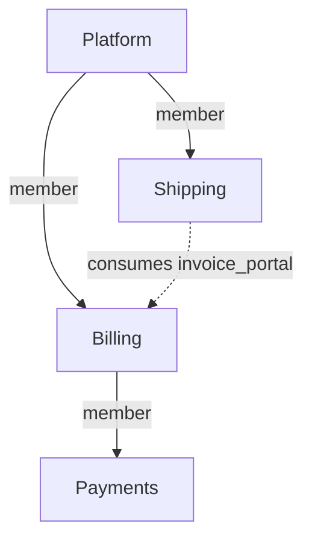

# Wairon: compose projects without changing their meaning

Based on the supplied problem statement, Revision 2, dated 12 September 2026. This is a design proposal without repository inspection. All schemas, commands, and diagnostic names below are proposed. YAML excerpts omit unrelated required fields. The proof sections specify acceptance tests; they do not report executed implementation tests.

## Model in one page

**A chained subsystem should become a project membership relation, outside the L0–L5 hierarchy.** Keep one project model and two explicit relations: **membership** says which projects constitute a system; **consumption** says which published contracts a project uses. These relations are independent. Membership permits composition analysis; consumption permits architectural references. Neither grants editing or approval authority.

Each project owns its L0, L1 subsystems, remaining specs, configuration, approval, and generated files. A parent groups project architectures without merging their records or demoting a child's L0 into L1. Billing and Shipping remain project boundaries even when Platform displays their communication as internal to its composition. Looking inside Billing does not authorize calling its private components.

Identity is `(projectId, localSpecId)`. Both identifiers survive moves and display-name changes. Mount aliases and filesystem paths are locators. References use local ids or consumer-owned dependency aliases, such as `dep:billing/invoice_portal`. The alias resolves through Shipping's own manifest to Billing's stable project identity.

Validation answers two explicit questions:

1. **Project validity:** does this project's snapshot satisfy its declared policies, approval state, and locked contract inputs?
2. **Composition validity:** do the selected project snapshots satisfy their own gates, the composition's additional policies, and each other's contract requirements?

A composition never replaces project findings. Every result identifies its input and policy digests. A detached Shipping can validly target Billing contract C1 while a proposed Platform containing incompatible C2 fails integration. Those are different propositions. The same proposition must have the same result from either scope.

The parent governs admission and system integration. Shared internal doctrine is an explicit, pinned policy dependency that children adopt and the parent requires. A child can decline a new requirement and remain a valid independent project; the parent can decline that child version. If several teams need one unconditional approval and policy authority, keep their subsystems in one project. Directory partitioning alone is insufficient reason to manufacture another project.

| Commitment | Decision and consequence |
|---|---|
| R1 — One verdict | **Keep its explicit-difference allowance.** Equality is for the same edge, snapshots, policy, and question; never an unqualified green badge. |
| R2 — Independent child | **Keep.** Local inputs suffice for its own gate; independence does not promise compatibility with every parent. |
| R3 — First-class parent | **Weaken ownership, preserve capability.** The parent inspects, integrates, approves a composition, and delegates across authorized members; it cannot silently replace their governance. |
| R4 — Write ownership | **Keep.** Cross-project work names each write target explicitly. |
| R5 — Round-trips | **Keep.** Parent-mediated editing invokes the same owner-scoped operation. |
| R6 — Confinement | **Refine.** A child accesses its own data and explicitly granted contract/context artifacts. Family visibility requires member grants; ancestry is not authorization. |
| R7 — No location softening | **Keep.** No ancestor discovery or disk-dependent evidence substitution. |
| R8 — Layouts | **Keep.** Source location is separate from project identity. |
| R9 — Nesting | **Keep finite arbitrary depth.** Membership is acyclic; repeated membership can form a DAG. |
| R10 — Proportional cost | **Keep.** Validate local ownership and consumed inputs; evaluate broader rules only when requested. |
| R11 — Predictability | **Keep for architecture.** Manifests, input locks, and explicit contexts determine resolution and judgement. Hosted authorization remains an additional server responsibility. |

## 00 — The model: what a chained subsystem is

**Diagnosis.** Storage containment is being used as architecture containment, identity scope, policy authority, and an authorization boundary. These are different relationships. A `kind` switch alone would still leave their coupling unexplained.

**Options.**

- **One recursively flattened system:** simple authority, but genuinely independent child configuration and approval disappear; sacrifices R2 to maximize R3.
- **Declared `federated` and `dependency` mounts:** makes the principal tradeoff visible, but multiplies behavior across nesting and kind changes. R9 and R11 need a composition table for mixed kinds.
- **One project model, membership plus consumption:** preserves R2 and R9; limits R3's unilateral authority. Recommended.

**Recommendation.** Move composition out of L1:

```yaml
projectId: syw.platform
members:
  billing:
    project: syw.billing
    source: {path: services/billing}
```

This does not itself create a dependency or export. An unrelated project can import Billing's contracts without adding Billing as a member. Membership can expose the full architecture to authorized reviewers; dependencies expose only their declared contracts. A child's L0 stays L0, shown inside a project grouping in the parent's view.

**Migration.** Introduce a versioned schema and convert `projectPath` into membership. Generate separate imports for actual cross-project references. Existing projects continue in legacy mode; adopting the new schema requires updated clients. Do not label legacy and new results equivalent where governance changes.

**Proof.** Loading Billing alone or through two different parents yields the same owned graph. Dependency-only access cannot resolve a private Billing target. Membership cycles fail explicitly; adding another nesting level changes neither identities nor validation rules.

## 01 — Mount and realization: two specs for one subsystem

**Diagnosis.** A transport record and an owned architectural object impersonate the same L1 entity. Same-name merging is hiding that type error.

**Options.**

- **Mount owns the boundary:** coherent for one system, but the child needs a copied boundary to stand alone, weakening R2 and R4.
- **Child overrides mount:** improves independence but institutionalizes discarded parent data, violating R11.
- **Membership owns no subsystem semantics:** one authoritative L1 per owning project; satisfies R2, R5, and R9.

**Recommendation.** Remove `publicInterfaces`, `trustedLinks`, and L1 identity from membership records. The child owns its actual L1 subsystems. A project's surface is derived from its own L1 publications, with canonical project/spec identities. Descendant exports are not automatically the parent's exports.

A membership may carry a contextual `role` description; it cannot replace the child's vision. Explicit re-export, if needed later, must reference an existing contract and preserve its origin and access restrictions rather than duplicate its declaration.

Creating a service project creates an L0 and a real initial L1. A deliberately empty project is allowed, but components referencing a nonexistent subsystem are invalid in every view. Shipping's `dispatch` and Payments' `payments` need no special treatment.

**Migration.** Compare mount and child declarations before removing anything. Preserve identical data once; report conflicting publication/trust data for a decision. Move a mount description into membership metadata. Missing child L1s require explicit child-targeted repair. Conflict-free conversion preserves declarations; conflicting or orphaned cases necessarily change observable results. A format upgrade cannot safely guess the meaning of silently ignored metadata.

**Proof.** Flat, non-flat, and depth-three fixtures contain exactly the authored L1s from both scopes. Every component's subsystem exists. No empty mount subsystem appears in status, topology, or boundary evaluation.

## 02 — Identity and references across roots

**Diagnosis.** A loader's route to a project has become the project's identity. Tail matching and implicit absolute-name detection then compensate for ambiguous addressing.

**Options.**

- **Strict `super::` paths:** removes some ambiguity but keeps references coupled to parent topology; weakens R8 and R11.
- **Globally qualified references everywhere:** stable and simple, but verbose; preserves R5 and R11.
- **Stable identity with owner-local aliases:** the same semantics with readable authoring; preserves R5, R8, and R11.

**Recommendation.** Use immutable, namespace-qualified project ids such as `syw.billing`; display names remain mutable. Local spec ids are unique within their owning project. Treat an intentional identifier change as a migration.

```yaml
# Shipping's project.yaml
imports:
  billing:
    project: syw.billing
    contracts: [invoice_portal]

# Shipping's component / narrative references
dependsOn: ["dep:billing/invoice_portal"]
target: "dep:billing/invoice_portal#create_invoice"
```

The authoring project is always Shipping, even when the MCP session opens at Platform. Resolve to `(syw.billing, invoice_portal, create_invoice)` together with the explicitly selected contract or provider-snapshot digest. Revisions select an incarnation of an identity; they are not mount prefixes.

Reject undeclared imports, ambiguous provider identities, out-of-bounds `super::`, and legacy root-sensitive `::` in the new schema. Deduplicate graph edges after canonical resolution. Preserve authored spelling on ordinary saves; canonicalization is an explicit formatter operation. Platform may still display `billing::invoice_portal` as a breadcrumb, never as stored identity.

**Migration.** Resolve old references using a declared legacy family context, then write owner-local imports and references. Compare live and pinned candidates; do not turn the old first-tail-match winner into an unquestioned identity. Unambiguous references migrate mechanically; ambiguous collisions and clamped references require repair. Rewrite every affected owning project, not just the parent.

**Proof.** Renaming a membership alias, relocating a checkout, and changing nesting preserve canonical targets. Two providers publishing `portal` remain distinct. Pin order has no effect. Identical owner-scoped MCP edits through child and parent produce identical files.

## 03 — Governance: whose rules judge a child's specs

**Diagnosis.** Configuration selection is a loader side effect. A rule's authority and applicability are absent from the finding.

**Options.**

- **Top-root override:** prioritizes R3 but violates R2 and R7.
- **Child-only governance:** preserves R2 and R7 but provides no system admission criteria, limiting R3 too far.
- **Owner policy plus explicit composition requirements:** preserves independent judgement while allowing the parent to reject an unsuitable composition; satisfies the revised R3.

**Recommendation.** The owner evaluates every owned spec under its own configuration and pinned policy imports. Parent requirements are additional predicates, never replacements:

```yaml
# Each participating service, including Payments
policy:
  profiles: ["syw.service@sha256:P1"]

# Platform
composition:
  requirePolicies:
    - {profile: "syw.service@sha256:P1", scope: descendants}
```

`P1` is a symbolic digest here. A required profile defines a floor its adopters cannot disable. Local rules may add constraints. Suppressions name their issuing policy; a parent suppression cannot waive a child's finding. For the same rule semantics, severities combine by the stricter floor. Distinct pack predicates remain separate obligations; incompatible predicates produce a policy conflict, not a guessed merge.

Each composition node's requirements apply over its declared scope. Thus Billing's Payments requirements and Platform's descendant requirements both apply. No special top-root authority skips Billing. Project type and target language are explicit owner values; scaffolding may copy defaults once. General automatic inheritance would make detached interpretation depend on missing files.

**Migration.** Keep child configurations intact; translate existing parent-wide doctrine into explicit composition checks. Report changed outcomes. Adoption of a shared profile and any policy conflict resolution require ordinary project changes and approval, not silent config rewriting. Where the two scopes previously disagreed, no migration can preserve both verdicts while making them consistent.

**Proof.** The statement's invalid child-internal Orchestrator edge remains an error with a parent configured to error, warn, or off. Payments sees the same adopted profile locally and through Platform. Updating Platform's required profile fails admission until adoption; it does not rewrite Payments' current policy.

## 04 — One edge, one verdict: composing judgements across roots

**Diagnosis.** Resolution, evidence selection, authority, and diagnostic aggregation are intertwined. Replacing selected diagnostic codes cannot establish semantic consistency.

**Options.**

- **Live tree wins when present:** catches integration drift but makes checkout contents select the question; violates R7 and R11.
- **Pins always win:** makes the child reproducible but cannot establish that the selected family provides its dependencies; weakens R3.
- **Explicit project and composition assessments:** preserves R1's qualified equality, R2, R3, and R7. Recommended.

**Recommendation.** Define the project evaluator `V(P)` over P's selected owned specs and code, owner approval, owner configuration, pinned contracts, and validator/pack versions. A family context F selects project snapshots and actual provider bindings:

```text
Family(F) = all V(P) for selected members and the root
            AND all import-to-provider compatibility checks in F
            AND all applicable composition policy checks
```

Here AND means all required assessments must pass. Findings are retained with their issuer and basis; they are not replaced or collapsed by diagnostic code. Owner findings are identical whether requested directly or collected by a family run.

```bash
wairon validate --ci
wairon validate --family --inputs working --ci
wairon validate --context .wai/contexts/platform-F1.yaml --ci
```

The first checks the owner's current snapshot against locked inputs. The second explicitly snapshots the declared working family and checks every imported contract against its selected provider, even if an owner pin already passed. The third evaluates the explicitly supplied immutable context. Materialized bytes must match its selected digests; a different checkout is not a substitute. An old context can pass only as an assessment of those old snapshots; its output must identify them.

There is no ancestor fallback. Missing inputs produce `incomplete`, which fails CI. Unsupported required code analysis also produces incomplete coverage. Unwaived warnings continue to fail CI.

Code conformance belongs to the source file's owner. Each analyzer checks its outgoing imports/calls, including imports across project boundaries, against canonical dependency and exported-symbol mappings. Family validation runs or reuses those owner checks and verifies provider bindings. Ownership indexes exclude nested child roots from parent code scanning; every file has exactly one owner. A cross-project import unsupported by the language adapter is not silently ignored.

Settledness comes from the spec owner's approval. Cache keys include all semantic inputs, source digests, approval state, and analyzer versions.

**Migration.** Replace fallback merging with a shared evaluator and an explicit assessment context. Run old and new evaluators side by side during adoption to expose verdict changes. Correct cases remain compatible; projects relying on missed or softened findings will deliberately start failing.

**Proof.** For identical inputs, a family report's owner findings equal a direct owner run. Deleting a selected provider method or export fails integration from Platform and from Shipping supplied with the same context. Parent-code-to-child and child-code-to-parent import fixtures both fail when undeclared. Changing the working directory or adding an unused checkout changes nothing.

## 05 — Contracts across the boundary: pins and freshness

**Diagnosis.** Pins are simultaneously dependency declarations, caches, and approximate freshness indicators. Their family-wide hash describes the wrong change boundary.

**Options.**

- **Always refresh family surfaces:** catches some changes but violates reproducibility and risks R4 through automated updates.
- **Make pins detached-only caches:** preserves a live family gate, but fails R7 unless input selection becomes explicit.
- **Lock declared contract inputs; compare selected provider outputs separately:** satisfies R2, R7, R10, and R11.

**Recommendation.** Use one import mechanism for relatives, unrelated projects, and hosted publications:

```yaml
# Shipping: .wai/inputs.lock.yaml
imports:
  billing:
    project: syw.billing
    contracts:
      invoice_portal:
        digest: sha256:C1
        artifact: surfaces/billing-invoice-C1.yaml
```

The artifact records publisher identity and provenance, exported component identity and stereotype, method signatures, reachable contract types, and publication/access metadata. Its digest covers those semantics, excluding unrelated specs and the consumer's own imports. It is an immutable expected input, not evidence of current deployment availability.

Initially lock complete named interfaces and their type closure. Compatibility compares the promised interface with the selected provider's interface: additions may be compatible; removed methods, narrowed access, or incompatible signatures fail. Unsupported compatibility cases are reported as unknown, not presumed safe.

| Observation | Gate behavior |
|---|---|
| A newer contract exists | Informational; do not mutate the lock. |
| Selected provider still satisfies the pinned contract | Integration passes even when digests differ. |
| Selected provider breaks the contract or removes the export | Integration fails. |
| Required artifact/provider evidence is missing or corrupt | Incomplete/error; CI fails. |
| Import is unused | Informational; explicit pruning command. |

Replace `surface pin`'s family enumeration with explicit `deps add`, `deps update`, and `deps check --context F`. Fetching or importing writes only the requesting project's inputs. Platform's own public contracts replace the special “family surface”; descendants need explicit imports just like any other provider.

**Migration.** Convert pins only when their provider/export provenance is unambiguous. Rebuild or reacquire insufficient artifacts. Retire the whole-family freshness hash. Existing valid snapshots can remain pinned without contacting the original parent.

**Proof.** An unrelated Payments edit changes neither Shipping's contract digest nor its project result. A renamed Billing method fails the selected composition from both scopes. Duplicate export names never select the wrong provider. Validation never rewrites pins.

## 06 — Working from the child's own root: status, topology, briefs

**Diagnosis.** Each output reconstructs its own interpretation of ownership, while approval unexpectedly triggers child initialization and generation.

**Options.**

- **Opaque child delegates only:** protects autonomy but unnecessarily limits R3.
- **Flatten all agents and regenerate everything:** improves parent reach while violating R4 and risking R6.
- **Shared project-aware graph with owner-scoped operations:** preserves R3–R6 and R10.

**Recommendation.** Status, topology, briefs, and validation consume the same canonical graph and assessment context. Local views include owned components and declared external contracts. Family views can collapse or expand member projects. Aggregate unique owned specs, not averages of project percentages; do not count repeated membership twice.

```bash
wairon topology --family --expand syw.billing
wairon brief --project syw.shipping --component dispatch_adapter
wairon generate --project syw.shipping
```

A parent orchestrator can brief a child component, but the work item explicitly targets Shipping's project root and includes its policy/input digests. External context contains authorized contracts, not arbitrary provider internals. An owner delegate remains a useful routing default rather than a model restriction.

`lock` writes approval only. Generation and project repair are separate, explicitly targeted operations. Parent-mediated edits use the same owner service as child-mediated edits:

```json
{"tool":"spec.update","projectId":"syw.shipping","specId":"dispatch_adapter",
 "expectedDigest":"D1","patch":{"description":"Dispatch and request an invoice"}}
```

**Migration.** Stop implicit generation on all forms of lock. Expose explicit generation commands and repair orphan subsystem references using issue 01's migration. Preserve existing delegate views as the collapsed presentation. Specs remain compatible; automation relying on lock's generation side effects must invoke generation explicitly.

**Proof.** Child status equals the owned portion of the family status. Parent and child produce equivalent briefs for the same inputs. Locking Platform leaves every child file byte-for-byte unchanged. Expanded and collapsed topology count the same underlying components.

## 07 — Approval across a family

**Diagnosis.** A local approval and a composition approval are different promises. A direct-child lock pointer cannot prove that an arbitrarily deep current tree still matches approved content.

**Options.**

- **Parent approves every loaded spec:** simplifies a global badge, but defeats independent R2 governance and may violate R4.
- **Only local approvals:** preserves R2 and R4, but cannot fulfill composition approval under R3.
- **Local approvals plus explicit recursive composition approval:** preserves all three with two clearly labelled scopes.

**Recommendation.** Keep per-spec owner approvals. Bind their validity to the approved semantic configuration and input locks as well as spec digests. Add an optional composition section to the same project approval record:

```text
ownSubject(P) = H(project identity, owned specs, semantic config, input locks)

compositionSubject(P) = H(ownSubject(P), membership and selected bindings,
                          child composition subjects, integration policy/context)
```

For leaves, the composition contribution is derived from their approved own subject. Hash subjects, not approval timestamps, signatures, or the approval file itself. Transport aliases/paths do not change semantic identity; selected content does.

`lock` approves only the selected project's own subject. `lock --family --context F` approves its composition and requires recursively approved, matching selected members and successful integration. An intermediate project with children needs matching composition approval for its selected child arrangement. Both commands write only their target project's record. A parent can approve its own architecture before children are ready; status must say “own specs approved; composition incomplete.”

Approval preflight judges the candidate specs at settled strictness, so locking cannot turn today's accepted completeness warnings into tomorrow's newly settled errors. Code conformance evidence is separate, bound to the checked source/spec/tool digests; architecture approval is not a promise about arbitrary future code.

Verify actual selected content recursively. An unchanged Billing lock does not prove unchanged Payments. Historical approval remains valid for its historical snapshot; drift blocks claiming it covers the new composition.

**Migration.** Preserve old records as historical local approvals, with their original basis. Do not invent approvals for unapproved children or silently certify them under new policies. New composition approval requires the newly specified checks.

**Proof.** Editing Payments while leaving both ancestor lock files untouched makes current-family approval fail from Payments, Billing, and Platform. Reapproval propagates changed subjects upward. Parent locking modifies no child. Missing child approval cannot become a fully approved badge.

## 08 — Repository layouts and version control

**Diagnosis.** Filesystem nesting is doing dependency resolution, while backup operates over only one of the project's storage locations.

**Options.**

- **Require nested checkouts/submodules:** operationally simple, but drops part of R8.
- **Allow arbitrary paths directly from project YAML:** supports layouts but turns a manifest into ambient filesystem access, conflicting with R6.
- **Explicit source bindings within an authorized workspace:** preserves R6, R8, and R11.

**Recommendation.** Support nested paths, registered workspace projects, and immutable fetched sources:

```yaml
members:
  billing:
    project: syw.billing
    source: {workspace: billing}

---
# Separate, explicitly selected workspace descriptor
projects:
  billing:
    project: syw.billing
    path: ../billing
```

Resolve paths against the declared descriptor, verify project identity and content, and enforce authorized real paths. Hosted source bindings resolve through registered project records rather than user-supplied paths. Keep the existing nested-path escape restriction for that source form; side-by-side support should not silently relax it.

A missing required member makes a working-family assessment incomplete. An immutable context may use exact cached snapshots and trusted matching analysis evidence. A contract-only dependency needs its contract, not the provider's whole checkout.

Git revision and approval subject remain separate, linked evidence: a commit locates bytes; approval records a human decision about specific semantics. A source-only commit can preserve architectural approval while invalidating code-analysis evidence.

Hosted backup enumerates all authorized member roots. Commit all relevant `.wai` paths once per Git repository; handle submodule repositories separately. Record a composition manifest connecting their revisions and approval subjects. Retain the underlying objects/artifacts, not just commit strings. State separately whether a backup includes source code or only architecture data.

**Migration.** Existing nested paths remain valid bindings. Add workspace bindings for separate repositories and expand hosted backup coverage. No content migration is needed merely to choose another transport; version the expanded backup format and retain support for older restores.

**Proof.** Equivalent monorepo, submodule, and side-by-side snapshots yield equal semantic results from both scopes. A restored family reproduces approvals and inputs at every depth. Symlinks cannot change ownership or escape authorized roots.

## 09 — Hosted: a child as a project, a part, or both

**Diagnosis.** Hosted identity is tied to top-level storage, and confinement is an accumulating tool exception list.

**Options.**

- **Top-level records with more child forwarding:** cheap initially, but repeats the R2/R6 mismatch for each new tool.
- **Independent records with automatic ancestor privileges:** improves R2 but makes project reuse dangerous under R6.
- **Independent records with explicit membership grants and typed capabilities:** preserves R2, revised R3, and R6.

**Recommendation.** Register every project once, with its own policy, approval page, history view, and permissions. Several composition records may point to it. Monorepo projects share a repository service without sharing project authorization.

Bind every operation to a resource and capability: `(principal, projectId, action, permitted artifacts)`. Implement this in the common project service and filesystem gateway. A new tool cannot bypass it by forgetting a child-specific branch. A project id read from YAML is not sufficient to acquire access to a hosted record.

Family access requires explicit member grants. Child-scoped access excludes other project roots, including nested ones, except for deliberately shared contract/context artifacts. Sessions identify their bound project, allowed operations, and any disclosed membership context.

The UI can open Shipping directly or through Platform and invoke the same approval workflow. Audit records the actor, target project, operation, and initiating composition, without routing ownership to Platform. Organizational units group people and policy; architectural `member`/`consumes` relations use the same graph in hosted relation-health views.

A child can revoke its own delegation grant or retire its availability. Removing a membership declaration owned by Platform still requires a Platform change. “Detach” is not permission to edit another project.

**Migration.** Create records for existing children and map existing narrowed tokens to explicit capabilities. Preserve their current restrictions unless deliberately expanded. Migrate audit provenance and source bindings; existing parent access becomes recorded grants, not inferred permanent power.

**Proof.** Run every tool, including archive, generation, backup, and future-tool defaults, with child-scoped credentials. Unauthorized reads/writes and path escapes fail centrally. The same authorized Shipping edit through its page or Platform targets the same record and produces the same content.

## 10 — Migrations: create, externalize, internalize, move, rename

**Diagnosis.** Ownership-changing operations are implemented as file moves plus partial string rewrites. They need graph transformations with an explicit affected-owner set.

**Options.**

- **Best-effort rewrite of checked-out files:** convenient, but violates R5 and R11 when absent consumers break.
- **Always require the entire family online and writable:** safer, but unnecessarily limits R2, R8, and R10 for alias/path-only changes.
- **Classify transformations by semantic effect; plan all affected writes:** preserves the commitments with honest limits on cross-repository atomicity.

**Recommendation.**

| Operation | Required change |
|---|---|
| Create | Explicitly create the child L0/L1/config and parent membership; never defer scaffolding to lock. |
| Rename membership alias | Parent metadata only; consumer aliases and canonical ids remain unchanged. |
| Move checkout | Source binding and any necessary VCS metadata; verify source resolution remains equivalent. |
| Reparent/add membership | Composition declarations, grants, and applicable requirements; no consumer reference rewrite. |
| Externalize a subsystem | New owning project, reference/import rewrites in all affected owners, publication and boundary checks, path rebasing, approval drift. |
| Internalize a project | Move all selected local subsystems with an explicit collision map; preserve nested project memberships. No flat-child restriction. |
| Rename stable project/spec id | Breaking identity migration; update known consumers or maintain a real compatibility publication under the old identity. |

Changing membership into mere consumption is a relation edit, not a project kind migration. Adding membership likewise does not grant private dependency access.

Plans contain expected input digests, owner-by-owner patches, identity mappings, boundary changes, approval impact, and unavailable owners. A stale precondition stops application. Extraction can create new architectural boundaries; a transformation must report newly required Adapters/contracts rather than assume moving files preserves validity.

Within one repository, publish the complete change in one commit. Across repositories, prepare compatible releases or patches and publish the new immutable composition manifest last. This is an atomic selection of versions, not a globally atomic edit of independent Git repositories. If required owners are unavailable, leave the migration explicitly pending. Unknown detached consumers require compatibility/versioning, not a claim of exhaustive rewriting.

**Migration.** Add a plan/apply layer around existing operations, using canonical graph resolution. Accept nested selections and multi-subsystem internalization. Keep old identities available during staged public migrations where needed.

**Proof.** Path and alias changes preserve every canonical edge from all scopes. Ownership-changing transformations preserve intended targets under their explicit mapping and revalidate new boundaries. Missing owners or concurrent edits cannot produce a successful “complete” result. Failure leaves the previous committed composition usable.

## Worked example — Platform, Billing, Payments, Shipping

Assume the invoice method is `create_invoice(shipment_id: string) -> InvoiceId`, and all omitted L0 content, implementations, local narratives, and required type definitions are complete and conforming. `P1`, `C1`, and `F1` stand for actual content digests in real files. Pinned artifacts are available locally.

Each project declares only relationships it owns; children need no parent pointer:

```yaml
# platform/.wai/project.yaml
projectId: syw.platform
policy:
  profiles: ["syw.service@sha256:P1"]
members:
  billing:
    project: syw.billing
    source: {path: services/billing}
  shipping:
    project: syw.shipping
    source: {path: services/shipping}
composition:
  requirePolicies:
    - {profile: "syw.service@sha256:P1", scope: descendants}
---
# platform/services/billing/.wai/project.yaml
projectId: syw.billing
policy:
  profiles: ["syw.service@sha256:P1"]
members:
  payments:
    project: syw.payments
    source: {path: payments}
---
# platform/services/billing/payments/.wai/project.yaml
projectId: syw.payments
policy:
  profiles: ["syw.service@sha256:P1"]
---
# platform/services/shipping/.wai/project.yaml
projectId: syw.shipping
policy:
  profiles: ["syw.service@sha256:P1"]
imports:
  billing:
    project: syw.billing
    contracts: [invoice_portal]
```

The existing L0 visions remain owned by their respective projects. The membership view is:



The actual L1 declarations remain local:

| Owner | L1 id | Publication and trust |
|---|---|---|
| Platform | `core` | `publicInterfaces: [core_portal]` |
| Billing | `billing` | `publicInterfaces: [invoice_portal]` |
| Payments | `payments` | No export is needed for this example. |
| Shipping | `dispatch` | `trustedLinks: ["dep:billing"]`; no export is needed. |

Here the proposed `trustedLinks` alias permits dispatch's outgoing use of the contracts declared under that import. Billing's publication permits architectural consumption by declared importers; it is not a grant of hosted read access. A restricted consumer audience, when declared, is checked separately as part of the provider contract.

Billing declares the provider:

```yaml
# L2
id: invoice_portal
subsystem: billing
stereotype: Portal
interface: invoice_contract
---
# L3
id: invoice_contract
component: invoice_portal
methods:
  - name: create_invoice
    parameters: {shipment_id: string}
    returns: InvoiceId
```

Shipping declares the consumer and call:

```yaml
# L2
id: dispatch_adapter
subsystem: dispatch
stereotype: Adapter
dependsOn: ["dep:billing/invoice_portal"]
---
# L5 excerpt
component: dispatch_adapter
method: dispatch
steps:
  - number: 1
    call:
      target: "dep:billing/invoice_portal#create_invoice"
      args: {shipment_id: shipment.id}
```

Shipping's input lock is C1 as shown in issue 05. The canonical edge is always `syw.shipping/dispatch_adapter → syw.billing/invoice_portal#create_invoice`. Platform's `shipping` and `billing` aliases do not participate in its meaning.

| View | What is actually judged |
|---|---|
| **Shipping, own gate** | Dispatch is an Adapter; the dependency and outgoing trust are declared; C1 publishes the target; the method and arguments match; Shipping's code matches its specs. No parent is needed. |
| **Platform, composition F1** | Includes that exact Shipping assessment, Billing's own assessment, all other member assessments, P1 requirements, and verification that F1's selected Billing provides C1's promised interface and access. The edge is inside Platform's composition and still crosses a project boundary. |
| **Billing, own gate** | Validates its publication and implementation. It has no Shipping call site to judge. Output says inbound consumers are not assessed, rather than claiming the edge passed. |
| **Billing or Shipping, supplied with F1 context** | Judges the same integration obligation as Platform using the authorized context artifact. The result retains the original edge owner, policy issuers, and snapshot basis. |

Capture the family inputs explicitly:

```bash
# At Platform; writes the requested context artifact in Platform only
wairon context capture --family --inputs working --out .wai/contexts/platform-F1.yaml
wairon validate --context .wai/contexts/platform-F1.yaml --ci

# At Shipping, after an explicitly shared projection is available to it
wairon context import shipping-F1.yaml --name platform-F1
wairon validate --context .wai/contexts/platform-F1.yaml --ci
```

A projection supplies the required provider contracts, versioned policy, relevant consumer obligations, and evidence basis. It grants no sibling filesystem access. A predicate requiring omitted global facts needs a matching trusted composition attestation or is incomplete; a projection cannot masquerade as a whole-family check. Billing can consume an analogous projection to inspect inbound obligations.

Approve from the leaves upward:

| Approval | Promise |
|---|---|
| Payments own approval | Its owned architecture, policy, and locked inputs are accepted. |
| Billing composition approval | Billing's own subject, its exact approved Payments composition, and Billing's integration obligations are accepted. |
| Shipping own approval | Its architecture and use of expected contract C1 are accepted. It does not approve Billing's implementation or promise Billing will keep deploying C1. |
| Platform composition approval | Platform's own subject, approved Billing including Payments, approved Shipping, selected provider bindings, and Platform integration obligations are accepted for F1. |

Approvers need authority for their explicit targets. A platform-team member may also approve Billing if granted that role; invoking Platform's approval does not imply it.

**Now Billing renames `create_invoice` to `issue_invoice`, removing the old method.** Assume Billing updates its own implementation and narratives consistently. Its new surface is C2.

| Check | Consequence |
|---|---|
| Billing's own structural validation | Can pass; Billing's approval is drifted. A configured release-compatibility check against C1 also reports a breaking removal. Unknown consumers are not fabricated. |
| Shipping's own validation against C1 | Still passes on either checkout layout. Its unchanged approval remains an approval of C1-based work. |
| Platform working-family validation, or F2 capturing C2 | Fails `CONTRACT_METHOD_REMOVED`: Shipping requires C1's `create_invoice`, while selected Billing C2 omits it. Approval drift is a separate finding. |
| Shipping/Billing integration assessment with F2 | Reports the same integration failure as Platform. |
| Historical F1 assessment | Remains valid for the old snapshots. It says nothing about deploying C2. |

Payments' approval does not change. Billing's own and composition subjects change; Platform must not claim its F1 approval covers F2. Billing can publish an independently approved breaking version without forcing Shipping to adopt it, but that version cannot pass the existing Platform composition.

Either Billing retains `create_invoice` as a working compatibility method, or Shipping explicitly updates its import, call, implementation, and approval to C2 before Platform approves the new composition. Keeping the old Billing revision selected is also valid. No command silently rewrites Shipping or refreshes its pins. Renaming only an implementation symbol while preserving the L3/wire contract would instead be a local implementation change.

## Interactions

- **Identity, ownership, and migrations reinforce each other.** Alias and path changes become small. Moving ownership between projects remains a real API/identity migration; stable ids cannot make it consequence-free.
- **Governance and reproducibility reinforce each other.** Pinned policy imports make the child's rules available offline. A parent's newer requirement becomes an explicit admission failure until adopted. Conflicting policy predicates remain conflicts even if one severity is higher.
- **Approval requires the same snapshots as validation.** Canonical identities make recursive subjects possible; owner attribution makes settledness consistent. An approval digest alone is insufficient without matching actual content or trusted evidence for those exact snapshots.
- **Confinement limits aggregate claims.** A parent without a necessary member grant cannot claim complete family validation. A child receives authorized artifacts, not an implicit route into sibling repositories. Briefs, archives, validation, and generation must share the same boundary enforcement.
- **Offline operation limits freshness claims.** A detached clone cannot discover a later revocation. Historical contract validity and current deployment authorization are different checks. If immediate revocation matters, an explicit deployment gate must obtain current revocation/provider evidence and fail closed when its required freshness cannot be established.
- **Cost follows the obligation.** Contract and policy digests permit local caching and focused rechecks. Global cycle or system-wide policy rules may need a larger graph; R10 should not justify omitting facts required by a rule.

Issues 00/01/02/10 share the identity-and-ownership root cause; 03/04/05/07 share the missing assessment-basis root cause; 06/08/09 expose both through user-facing operations. I kept their headings separate so implementation work can still track the statement's issue ids.

## What I would not do

- Add per-tool `federated`, `independent`, `inherit`, `opaque`, and `livePreferred` switches. Independent relationship axes are clearer than a behavioral matrix of project kinds.
- Fix root-sensitive ids with more prefix heuristics, tail matching, or silent `super::` clamping.
- Treat a newer contract as automatically required, or an old valid pin as proof of a currently compatible deployment.
- Merge arbitrary findings by code, select whichever result is kinder, or let one authority's suppression erase another's obligation.
- Make approval initialize projects, generate child files, update dependencies, or approve descendants implicitly.
- Equate Git commits with human approval, promise atomic independent-repository rewrites, or assume all external consumers are discoverable.
- Add a global registry, mandatory signing infrastructure, or deployment-instance model before the stated requirements need them. Stable declared identity and explicit source provenance suffice for the initial design.

## Prior art — useful mechanisms and their limits

The applications and limitations below are architectural comparisons, not claims that these tools already implement the proposed wairon model.

| System | What genuinely applies | Where the analogy breaks |
|---|---|---|
| **[Bazel external repositories](https://bazel.build/external/overview)** | Canonical versus apparent repository names illustrate stable resolution through consumer-local aliases. Declared dependencies and on-demand fetching help R10. | Bazel's canonical names are canonical within a workspace, not universal project identities. Build dependency resolution does not establish team approval or independent architecture governance. |
| **[Cargo workspaces](https://doc.rust-lang.org/cargo/reference/workspaces.html) and [path dependencies](https://doc.rust-lang.org/cargo/reference/specifying-dependencies.html)** | Workspace membership and an actual dependency are distinguishable; a dependency's location is separate from its package name. Explicit workspace inheritance is useful precedent. | Members share a root lockfile; some settings are root-only. Copying those mechanics wholesale would undermine detached, independently governed wairon projects. A path dependency does not define architectural publication/trust. |
| **[Go modules with `replace`](https://go.dev/ref/mod#go-mod-file-replace)** | The consumer names a module and can explicitly select different source contents or a local directory. This is a good model for deliberate working-tree composition inputs. | Replacements apply in the main module/workspace context and are ignored in dependencies' manifests. Adopting implicit root-selected replacements would recreate wairon's scope-dependent meaning. Go's version machinery also is not human approval. |
| **[Nx module boundaries](https://nx.dev/docs/features/enforce-module-boundaries)** | Tagged project dependencies and graph-based constraints illustrate explicit policy applicability and cross-project import checking. | Workspace boundary rules do not themselves provide detached contract locks, multi-owner approval, or confined hosted project capabilities. Tags are selectors, not proof of authority. |
| **[Turborepo workspaces](https://turborepo.dev/docs/crafting-your-repository/structuring-a-repository)** | Package manifests and dependency structure provide a basis for composition-aware scheduling and incremental work. | Its documented workspace conventions reject nested packages. That layout model cannot stand in for R9's recursive project membership, and task orchestration does not define architectural judgement. |
| **[Git submodules](https://git-scm.com/docs/gitsubmodules)** | A superproject selects a child commit through a gitlink while the child retains its history. This is excellent source-selection precedent. | A commit pointer proves neither architectural approval nor current working-tree conformity. Nested content and backup objects still require explicit traversal and retention. |
| **[Nix flake inputs](https://nix.dev/manual/nix/2.34/command-ref/new-cli/nix3-flake.html)** | A lockfile represents a dependency graph with locked source selections. This closely matches explicit composition contexts and reproducible input acquisition. | A reproducible evaluation can consistently evaluate an architecturally unacceptable system. Input locks do not establish ownership, human approval, current runtime access, or consumer/provider behavioral compatibility. |
| **[Terraform modules](https://developer.hashicorp.com/terraform/language/modules)** | Explicit module calls, interfaces, and recursive composition separate a reusable unit from its use in a parent. | The root manages called resources as part of its configuration; repeated calls instantiate resources. A wairon membership instead points to an independently governed project. Also, [Terraform's dependency lockfile](https://developer.hashicorp.com/terraform/language/files/dependency-lock) tracks providers, not remote module selections: it is not an exact template for contract/module locking. |
| **[Backstage system model](https://backstage.io/docs/features/software-catalog/system-model/)** | Components, APIs, systems, and ownership are separate catalog concepts; a system exposes APIs while hiding implementation detail from consumers. Useful for hosted relations and browsing. | Catalog relationships are not evidence that code implements a method, a consumer is compatible, or an approval covers selected snapshots. Reuse its separation of concerns, not its labels as validator semantics. |
| **[C4 model](https://c4model.com/faq)** | Views at different abstraction levels can describe one underlying model. A family overview and a detailed child view need not duplicate architectural objects. | C4 does not prescribe a development or approval process. Its levels are not a rule for recursively turning repository L0s into L1s, nor a universal mapping from projects to systems. |
| **[Pact](https://docs.pact.io/pact_broker/can_i_deploy)** | Compatibility is recorded for particular consumer/provider versions; `can-i-deploy` asks about a selected combination. This is the closest analogy for Shipping-valid/C2-incompatible outcomes. | Pact verification does not enforce Adapter doctrine, project write ownership, approval, or all possible behavior. Wairon's structural surface comparison is weaker than executable provider verification; neither should claim more than its evidence. |
| **[DDD context maps, as implemented by Context Mapper](https://contextmapper.org/docs/context-map/)** | Membership and upstream/downstream relationships are explicit and distinct. Billing can be upstream of Shipping; a Shipping Adapter may implement an anticorruption layer. | Influence between teams is not filesystem ownership or automatic policy inheritance. A wairon project is not necessarily one bounded context, and a context-map relationship does not define a lockfile, permission grant, or compatibility proof. |

## Assumptions and questions for the maintainers

| Question | Assumption used in this proposal |
|---|---|
| Is a child project intended to be independently governed, or merely separately stored? | A complete project with its own L0 and release schedule is independent. Mere directory partitioning stays inside one project. If unilateral parent governance is non-negotiable, explicitly drop R2 for those partitions. |
| Are spec ids unique throughout each project, and who controls project-id namespaces? | Local ids are project-unique; the organization controls immutable `syw.*` identities. Clones retain identity; independent forks receive a new one. Hosted records verify identity rather than trust a YAML claim. |
| Can one composition select two versions or instances of the same project? | Initially no: one snapshot per project identity per composition. Repeated membership must select the same snapshot; conflicts fail explicitly. Runtime multiplicity would require a separately designed instance identity. |
| Must shared libraries obey the Adapter rule? | Existing default doctrine remains. Any justified library exception belongs to an explicit policy/profile with defined boundaries, not an implicit mount kind. |
| How much compatibility can each surface codec establish? | Method removal, publication changes, and supported signature relations are mechanically checkable. Behavioral equivalence is not. Required unknown checks block a complete gate or require an explicit, attributable waiver. |
| What makes imported approvals and cached conformance evidence trustworthy? | Existing reviewed Git provenance or hosted identity is the initial trust basis. Hashes identify content but do not authenticate an approver. Cross-organization evidence needs an explicit trust policy before being accepted. |
| Does deployment CI enforce the actual provider selection? | A composition gate must be attached to integration/release CI for its guarantees to matter operationally. Detached project validation alone is not a deployment-safety claim. |
| May dependency cycles exist? | Fixed contract artifacts can support them if doctrine permits. Membership cycles are forbidden. Consumption pins reference contract digests, not recursive provider approvals, so mutual imports do not create circular approval hashes. |
