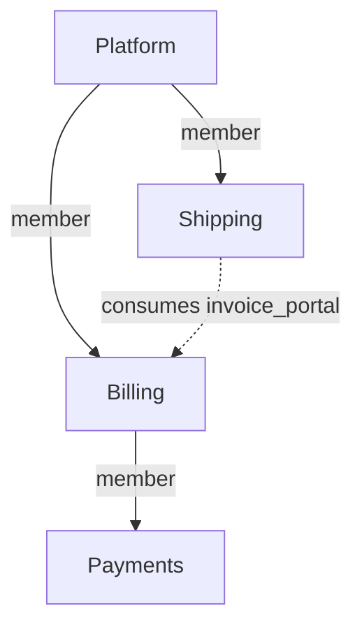

Based on the supplied Revision 2 statement. All schemas, commands, and diagnostics below are **proposed interfaces**. “Proof” means acceptance properties to implement, not tests run against the repository.

## Model in one page

**A chained subsystem should become a project membership relation, outside the L0–L5 hierarchy.** Keep one project model and two explicit relations:

* **Membership:** which projects constitute a system.
* **Consumption:** which published contracts a project uses.

These relations are independent. Membership enables composition analysis; consumption enables architectural references. Neither implicitly grants editing or approval authority.

Each project owns its L0, subsystems, remaining specs, configuration, approval, and generated files. A parent groups project architectures without merging their records or demoting a child’s L0 into L1. Billing and Shipping remain project boundaries even when Platform displays their communication as internal to its composition. Seeing Billing’s internals does not authorize calling its private components.

Identity is `(projectId, localSpecId)`. Identifiers survive relocation and display-name changes. Mount aliases and filesystem paths are locators. References use local ids or **consumer-owned dependency aliases**, such as `dep:billing/invoice_portal`, resolved through Shipping’s own manifest.

Validation answers two explicit questions:

1. **Project validity:** does this project satisfy its declared policies, approval state, and locked contract inputs?
2. **Composition validity:** do the selected projects satisfy their own gates, the composition’s additional policies, and each other’s contract requirements?

A composition never replaces project findings. Every assessment identifies its inputs and policies. Detached Shipping can validly target Billing contract C1 while Platform containing incompatible C2 fails integration. These are different propositions. The same proposition must yield the same result from either scope.

The parent governs admission and system integration. Shared internal doctrine is an explicit, pinned policy dependency that children adopt and the parent requires. A child may decline a requirement and remain independently valid; the parent may decline that child version.

If teams need one unconditional policy and approval authority, keep their subsystems in one project. Directory partitioning alone does not justify manufacturing an independent project.

| Commitment                     | Decision and consequence                                                                                                                                                                  |
| ------------------------------ | ----------------------------------------------------------------------------------------------------------------------------------------------------------------------------------------- |
| **R1 — One verdict**           | **Keep the explicit-difference allowance.** Equality requires the same edge, snapshots, policies, and question.                                                                           |
| **R2 — Independent child**     | **Keep.** Its own gate requires no parent; passing does not promise compatibility with every composition.                                                                                 |
| **R3 — First-class parent**    | **Weaken ownership, preserve capability.** The parent inspects, integrates, approves a composition, and delegates across authorized members; it cannot silently replace their governance. |
| **R4 — Write ownership**       | **Keep.** Cross-project work explicitly names each write target.                                                                                                                          |
| **R5 — Round-trips**           | **Keep.** Parent-mediated editing invokes the same owner-scoped operation.                                                                                                                |
| **R6 — Confinement**           | **Refine.** A child accesses its own data and explicitly granted artifacts. Family visibility requires member grants; ancestry is not authorization.                                      |
| **R7 — No location softening** | **Keep.** No ancestor discovery or disk-dependent evidence substitution.                                                                                                                  |
| **R8 — Layouts**               | **Keep.** Source location is separate from identity.                                                                                                                                      |
| **R9 — Nesting**               | **Keep finite arbitrary depth.** Membership is acyclic; reuse can produce a DAG.                                                                                                          |
| **R10 — Proportional cost**    | **Keep.** Local validation loads owned data and consumed inputs; broader obligations require broader evidence.                                                                            |
| **R11 — Predictability**       | **Keep for architecture.** Manifests, locks, and explicit contexts determine resolution and judgement. Hosted authorization remains an additional server responsibility.                  |

## 00 — The model: what a chained subsystem is

**Diagnosis.** Storage containment is being used as architectural containment, identity scope, policy authority, and an authorization boundary. A `kind` switch alone would leave those relationships coupled.

**Options.**

* **One recursively flattened system:** simple authority, but independent child configuration and approval disappear; sacrifices R2 to maximize R3.
* **Declared `federated` and `dependency` mounts:** exposes the principal tradeoff, but multiplies behavior across nesting and kind changes. R9 and R11 need rules for every mixed composition.
* **One project model, membership plus consumption:** preserves R2 and R9 while limiting R3’s unilateral authority. Recommended.

**Recommendation.** Move composition out of L1:

```yaml
projectId: syw.platform
members:
  billing:
    project: syw.billing
    source: {path: services/billing}
```

This creates neither a dependency nor an export. An unrelated project can consume Billing’s contracts without adding Billing as a member.

Authorized membership views can inspect the full architecture; dependency views expose declared contracts. The child’s L0 stays L0, displayed inside a project grouping.

**Migration.** Introduce a versioned schema and convert `projectPath` into membership. Generate imports for actual cross-project references. Existing projects continue through a legacy reader; opting into the new schema requires updated clients. Where governance changes, do not claim equivalent old and new verdicts.

**Proof.** Billing loaded alone or through different parents yields the same owned graph. Dependency-only access cannot resolve private targets. Membership cycles fail explicitly. Additional nesting changes neither identities nor validation rules.

## 01 — Mount and realization: two specs for one subsystem

**Diagnosis.** A transport record and an owned architectural object impersonate the same L1 entity. Same-name merging hides that type error.

**Options.**

* **Mount owns the boundary:** coherent for one system, but the child needs copied declarations to stand alone, weakening R2 and R4.
* **Child overrides mount:** supports independence but institutionalizes discarded parent data, violating R11.
* **Membership has no subsystem semantics:** leaves one authoritative L1 per owning project; satisfies R2, R5, and R9.

**Recommendation.** Remove `publicInterfaces`, `trustedLinks`, and L1 identity from membership records. The child owns its actual subsystems.

A project’s surface derives from its **own** L1 publications, carrying canonical project/spec identities. Descendant exports do not automatically become parent exports.

Membership may carry a contextual `role` description, but cannot replace the child’s vision. A future explicit re-export should reference an existing contract and preserve its origin and restrictions rather than duplicate its declaration.

Creating a service project creates an L0 and a real initial L1. Deliberately empty projects are allowed, but components referencing nonexistent subsystems are invalid everywhere. Shipping’s `dispatch` and Payments’ `payments` require no special cases.

**Migration.** Compare mount and child declarations before removing anything. Preserve identical data once; report conflicting publications or trust for resolution. Preserve mount descriptions as membership metadata. Missing child L1s need explicit child-targeted repair. Conflict-free conversion preserves declarations; contradictory or orphaned cases necessarily change observable results.

**Proof.** Flat, non-flat, and depth-three fixtures contain exactly the authored L1s from both scopes. Every component’s subsystem exists. Empty mount subsystems disappear from status, topology, and boundary evaluation.

## 02 — Identity and references across roots

**Diagnosis.** The loader’s route to a project has become its identity. Tail matching and implicit absolute-name detection compensate for ambiguous addressing.

**Options.**

* **Strict `super::` paths:** removes some ambiguity but preserves coupling to parent topology, weakening R8 and R11.
* **Globally qualified references everywhere:** stable and predictable, but verbose; preserves R5 and R11.
* **Stable identities with owner-local aliases:** provides equivalent semantics with readable authoring; preserves R5, R8, and R11.

**Recommendation.** Use immutable, namespace-qualified project ids such as `syw.billing`. Display names remain mutable. Local spec ids are unique within their owning project.

```yaml
# Shipping's project.yaml
imports:
  billing:
    project: syw.billing
    contracts: [invoice_portal]
```

```yaml
# Shipping's references
dependsOn: ["dep:billing/invoice_portal"]

# Narrative call target
target: "dep:billing/invoice_portal#create_invoice"
```

The authoring project is always Shipping, even when the MCP session opens at Platform. Resolve to `(syw.billing, invoice_portal, create_invoice)` together with the explicitly selected contract or provider-snapshot digest.

Reject undeclared imports, ambiguous provider identities, out-of-bounds `super::`, and root-sensitive `::` in the new schema. Deduplicate **graph edges** after canonical resolution. Preserve authored spelling during ordinary saves; formatting is an explicit operation.

Platform may display `billing::invoice_portal` as a breadcrumb. It must not store that breadcrumb as identity.

**Migration.** Resolve old references using an explicit legacy family context, then write owner-local imports and references. Compare live and pinned candidates; do not canonize the old first-tail-match winner. Unambiguous references migrate mechanically. Ambiguous collisions and clamped references require repair. Rewrite every affected owning project.

**Proof.** Alias changes, checkout moves, and reparenting preserve canonical targets. Two providers publishing `portal` remain distinct. Pin order cannot affect resolution. Identical owner-scoped edits through parent and child produce identical files.

## 03 — Governance: whose rules judge a child's specs

**Diagnosis.** Configuration selection is a loader side effect. Findings lack explicit policy authority and applicability.

**Options.**

* **Top-root override:** prioritizes R3 but violates R2 and R7.
* **Child-only governance:** preserves R2 and R7 but provides insufficient system admission criteria under R3.
* **Owner policy plus explicit composition requirements:** preserves independent judgement while allowing the parent to reject unsuitable compositions.

**Recommendation.** The owner evaluates its specs under its configuration and pinned policy imports. Parent requirements are additional predicates:

```yaml
# Each service, including Payments
policy:
  profiles: ["syw.service@sha256:P1"]
```

```yaml
# Platform
composition:
  requirePolicies:
    - {profile: "syw.service@sha256:P1", scope: descendants}
```

`P1` represents a real digest.

A required profile defines a floor adopters cannot disable. Local rules may add constraints. Suppressions name their issuing policy; a parent suppression cannot waive a child’s finding.

For identical rule semantics, severity combines by the stricter floor. Distinct pack predicates remain separate obligations. Incompatible predicates produce a policy conflict rather than a guessed merge.

Each composition node’s requirements apply over its declared scope. Billing’s Payments requirements and Platform’s descendant requirements therefore both apply. Nothing skips intermediate parents.

Project type and target language are explicit owner values. Scaffolding may copy defaults once; automatic ongoing inheritance would make detached interpretation depend on missing files.

**Migration.** Preserve child configurations and translate parent-wide doctrine into explicit composition checks. Shared-profile adoption requires ordinary project changes and approval. Where scopes previously disagreed, no migration can preserve both verdicts while making them consistent.

**Proof.** The statement’s invalid child-internal Orchestrator edge remains an error with a parent configured to error, warn, or off. Payments uses the same adopted profile locally and through Platform. Updating Platform’s required profile fails admission until adoption; it does not rewrite Payments’ policy.

## 04 — One edge, one verdict: composing judgements across roots

**Diagnosis.** Resolution, evidence selection, authority, and diagnostic aggregation are intertwined. Replacing selected diagnostic codes cannot establish semantic consistency.

**Options.**

* **Live tree wins when present:** catches integration drift but lets checkout availability select the question, violating R7 and R11.
* **Pins always win:** makes detached validation reproducible but cannot establish that the selected family supplies its dependencies, weakening R3.
* **Explicit project and composition assessments:** preserves R1’s qualified equality, R2, R3, and R7.

**Recommendation.** Define `V(P)` over P’s selected owned specs and code, owner approval, configuration, pinned contracts, and validator/pack versions.

For a family context F:

```text
Family(F) =
    all owner assessments V(P)
    AND all import-to-provider compatibility checks in F
    AND all applicable composition policy checks
```

AND means every required assessment must pass. Retain findings with their issuer and basis; never replace them by diagnostic-code family.

```bash
wairon validate --ci
wairon validate --family --inputs working --ci
wairon validate --context .wai/contexts/platform-F1.yaml --ci
```

* The first checks the owner’s current snapshot against locked inputs.
* The second explicitly snapshots the declared working family and checks every imported contract against its selected provider, even when the consumer’s pin already passed.
* The third evaluates an explicitly supplied immutable context.

Materialized bytes must match selected digests. A different checkout is not a substitute. An old context may pass only as an assessment of those old snapshots; output must identify them.

There is no ancestor fallback. Missing required inputs produce **incomplete**, which fails CI. Unsupported required code analysis also produces incomplete coverage. Unwaived warnings continue to fail CI.

Code conformance belongs to the source file’s owner. Each analyzer checks outgoing imports and calls—including cross-project imports—against canonical dependencies and exported-symbol mappings. Family validation runs or reuses those owner checks and verifies provider bindings.

Ownership indexes exclude nested child roots from parent code scanning. Every source file has one owner. Unsupported cross-project import analysis is not silently skipped.

Settledness comes from the spec owner’s approval. Cache keys include semantic inputs, source digests, approval state, and analyzer versions.

**Migration.** Replace fallback merging with a shared evaluator and explicit contexts. Compare old and new results during adoption. Correct cases remain compatible; projects relying on missed or softened findings deliberately start failing.

**Proof.** A family report’s owner findings equal a direct owner run with identical inputs. Removing a selected provider method or export fails integration from Platform and from Shipping supplied with the same context. Undeclared imports fail in both directions across a project boundary. Changing the working directory or adding an unused checkout changes nothing.

## 05 — Contracts across the boundary: pins and freshness

**Diagnosis.** Pins mix dependency declarations, caches, and approximate freshness indicators. Their family-wide hash describes the wrong change boundary.

**Options.**

* **Always refresh family surfaces:** detects changes but defeats reproducibility and risks R4 through automatic writes.
* **Detached-only caches:** works only if choosing live versus cached inputs becomes explicit; otherwise violates R7.
* **Locked contract inputs plus separate provider comparison:** satisfies R2, R7, R10, and R11.

**Recommendation.** Use one import mechanism for relatives, unrelated projects, and hosted publications:

```yaml
# Shipping: .wai/inputs.lock.yaml
imports:
  billing:
    project: syw.billing
    contracts:
      invoice_portal:
        digest: sha256:C1
        artifact: surfaces/billing-invoice-C1.yaml
```

The artifact contains publisher identity and provenance, exported identity and stereotype, method signatures, reachable contract types, and publication/access metadata.

Its digest covers those semantics, excluding unrelated specs and the consumer’s own imports. It is an immutable expected input, not proof of current deployment availability.

Initially lock complete named interfaces and their type closure. Compare the promised interface against the selected provider: additions can be compatible; removed methods, narrowed access, and incompatible signatures fail. Unsupported compatibility cases are unknown, not presumed safe.

| Observation                                                 | Gate behavior                               |
| ----------------------------------------------------------- | ------------------------------------------- |
| A newer contract exists                                     | Informational; do not mutate the lock.      |
| Selected provider satisfies the pinned contract             | Integration passes, even if digests differ. |
| Selected provider breaks the contract or removes the export | Integration fails.                          |
| Required artifact/provider evidence is missing or corrupt   | Incomplete/error; CI fails.                 |
| Import is unused                                            | Informational; explicit pruning command.    |

Replace family enumeration with explicit `deps add`, `deps update`, and `deps check --context F`. Fetching writes only the requesting project’s inputs.

Platform’s own public contracts replace the special “family surface.” Descendants import those contracts like any other dependency.

**Migration.** Convert pins when provider/export provenance is unambiguous; rebuild or reacquire insufficient artifacts. Retire the family-wide freshness hash. Valid existing snapshots can remain pinned without contacting the original parent.

**Proof.** An unrelated Payments edit changes neither Shipping’s contract digest nor its own result. A Billing method rename fails the selected composition from both scopes. Duplicate export names never select the wrong provider. Validation never rewrites pins.

## 06 — Working from the child's own root: status, topology, briefs

**Diagnosis.** Each output reconstructs ownership differently, while approval unexpectedly initializes and generates child files.

**Options.**

* **Opaque delegates only:** protects autonomy but unnecessarily limits R3.
* **Flatten agents and regenerate everything:** improves parent reach while violating R4 and risking R6.
* **Shared project-aware graph with owner-scoped operations:** preserves R3–R6 and R10.

**Recommendation.** Status, topology, briefs, and validation consume the same canonical graph and assessment context.

Local views contain owned components and imported contracts. Family views can collapse or expand projects. Aggregate unique owned specs, not averages of project percentages; repeated membership must not double-count components.

```bash
wairon topology --family --expand syw.billing
wairon brief --project syw.shipping --component dispatch_adapter
wairon generate --project syw.shipping
```

A parent orchestrator may brief a child component, but its work item explicitly targets Shipping’s root and includes Shipping’s policy/input digests. External context contains authorized contracts rather than arbitrary provider internals.

An owner delegate remains a useful routing default, not a model restriction.

`lock` writes approval only. Generation and repair are separate targeted operations. Parent-mediated editing uses the same owner service:

```json
{
  "tool": "spec.update",
  "projectId": "syw.shipping",
  "specId": "dispatch_adapter",
  "expectedDigest": "D1",
  "patch": {"description": "Dispatch and request an invoice"}
}
```

**Migration.** Stop implicit generation on every form of lock. Preserve delegate views as the collapsed presentation. Repair orphan subsystems explicitly. Specs remain compatible; automation relying on lock’s generation side effects must invoke generation itself.

**Proof.** Child status equals its owned portion of family status. Parent and child produce equivalent briefs for identical inputs. Locking Platform leaves every child file unchanged. Expanded and collapsed topology represent the same components.

## 07 — Approval across a family

**Diagnosis.** Local approval and composition approval promise different things. A child lock pointer cannot establish that an arbitrarily deep current tree still matches approved content.

**Options.**

* **Parent approves every loaded spec:** simplifies the global badge but defeats independent R2 governance and risks R4.
* **Local approvals only:** preserves R2 and R4 but cannot fulfill R3’s composition approval.
* **Local approval plus explicit recursive composition approval:** preserves all three with clearly labelled scopes.

**Recommendation.** Keep per-spec owner approvals, bound to approved semantic configuration and input locks as well as spec digests. Add an optional composition section:

```text
ownSubject(P) =
    H(project identity, owned specs, semantic config, input locks)

compositionSubject(P) =
    H(ownSubject(P), membership and selected bindings,
      child composition subjects, integration policy/context)
```

For leaves, the composition contribution derives from the approved own subject. Hash subjects, not timestamps, signatures, or approval-file bytes. Transport aliases and paths do not change semantic identity; selected content does.

`lock` approves only its target project’s own subject.

`lock --family --context F` approves its composition and requires recursively approved, matching selected members plus successful integration. An intermediate project with children needs matching composition approval for its child arrangement. Both commands write only the target project’s record.

A parent may approve its own architecture before children are ready. Status must then say **“own specs approved; composition incomplete.”**

Approval preflight applies settled strictness to candidate specs. Locking must not convert accepted completeness warnings into newly settled errors.

Code-conformance evidence is separate and bound to checked source/spec/tool digests. Architecture approval does not cover arbitrary future code.

Verify actual selected content recursively. An unchanged Billing lock does not establish unchanged Payments. Historical approval remains valid for its historical snapshot; drift blocks claiming it covers the new composition.

**Migration.** Preserve old records as historical local approvals with their original basis. Do not invent descendant approvals or silently certify old content under new policies. New composition approval requires the new checks.

**Proof.** Editing Payments while leaving ancestor lock files untouched invalidates current-family approval from Payments, Billing, and Platform. Reapproval changes ancestor composition subjects. Parent locking modifies no child. Missing child approval cannot produce a fully approved badge.

## 08 — Repository layouts and version control

**Diagnosis.** Filesystem nesting performs dependency resolution, while backup covers only one storage location.

**Options.**

* **Nested checkouts/submodules only:** simple, but drops part of R8.
* **Arbitrary paths from project YAML:** supports layouts but gives manifests ambient filesystem access, conflicting with R6.
* **Explicit source bindings in an authorized workspace:** preserves R6, R8, and R11.

**Recommendation.**

```yaml
# Platform
members:
  billing:
    project: syw.billing
    source: {workspace: billing}
```

```yaml
# Explicitly selected workspace descriptor
projects:
  billing:
    project: syw.billing
    path: ../billing
```

Resolve paths against the declared descriptor, verify project identity and content, and enforce authorized real paths. Hosted bindings resolve through registered project records.

Keep the existing escape restriction for nested `path` sources. Side-by-side support must not silently relax it.

A missing required member makes working-family validation incomplete. An immutable context may use exact cached snapshots and trusted matching analysis evidence. Contract-only dependencies need their contracts, not provider checkouts.

Git revision and approval subject remain separate, linked evidence: a commit locates bytes; approval records a decision about semantics. A source-only commit can preserve architectural approval while invalidating code-analysis evidence.

Hosted backup enumerates all authorized member roots. Commit relevant `.wai` paths once per Git repository; handle submodule repositories separately. Record a composition manifest connecting revisions and approval subjects. Retain underlying objects or artifacts, not merely commit strings. Distinguish architecture backup from source-code backup.

**Migration.** Existing nested paths remain valid bindings. Add workspace bindings and expand backup coverage. Changing transport requires no architectural content migration. Version the expanded backup format and retain older restore support.

**Proof.** Equivalent monorepo, submodule, and side-by-side snapshots yield equal semantic results from both scopes. Restored families reproduce approvals and inputs at every depth. Symlinks cannot change ownership or escape authorized roots.

## 09 — Hosted: a child as a project, a part, or both

**Diagnosis.** Hosted identity follows top-level storage, and confinement is an accumulating list of tool exceptions.

**Options.**

* **More child forwarding from top-level records:** repeats the R2/R6 mismatch for each new tool.
* **Independent records with automatic ancestor privileges:** improves R2 but undermines R6 when projects are reused.
* **Independent records, explicit membership grants, typed capabilities:** preserves R2, revised R3, and R6.

**Recommendation.** Register each project once, with its own policy, approval page, history view, and permissions. Multiple compositions may reference it. Monorepo projects share a repository service without sharing authorization.

Bind every operation to a resource and capability:

```text
(principal, projectId, action, permitted artifacts)
```

Enforce this in the common project service and filesystem gateway. A new tool cannot bypass confinement by omitting a child-specific branch. A project id found in YAML cannot itself grant access to a hosted record.

Family access requires explicit member grants. Child-scoped access excludes other project roots—including nested ones—except deliberately shared contract/context artifacts.

Sessions disclose the bound project, allowed operations, and authorized membership context. The UI can open Shipping directly or through Platform and invoke the same workflow.

Audit records actor, target project, operation, and initiating composition. Organizational units group people and policy; architectural membership and consumption use the same graph in hosted relation-health views.

A child may revoke its delegation grant or retire its availability. Removing Platform’s membership declaration still requires a Platform change. “Detach” is not permission to edit another project.

**Migration.** Create records for existing children. Map narrowed tokens to explicit capabilities while preserving current restrictions unless deliberately expanded. Convert existing parent access into recorded grants rather than permanent inferred power.

**Proof.** Exercise every tool—including archives, generation, backup, and future-tool defaults—with child credentials. Unauthorized actions and path escapes fail centrally. The same authorized Shipping edit through either UI targets the same record and produces identical content.

## 10 — Migrations: create, externalize, internalize, move, rename

**Diagnosis.** Ownership changes are implemented as file moves and partial string rewriting. They require graph transformations with explicit affected owners.

**Options.**

* **Best-effort rewriting of present files:** convenient, but violates R5 and R11 when absent consumers break.
* **Require the entire family online for every change:** unnecessarily limits R2, R8, and R10 for alias/path-only operations.
* **Classify semantic effects and plan affected writes:** preserves the commitments while acknowledging cross-repository atomicity limits.

**Recommendation.**

| Operation                     | Required change                                                                                                        |
| ----------------------------- | ---------------------------------------------------------------------------------------------------------------------- |
| Create                        | Explicitly create child L0/L1/config and parent membership; never defer scaffolding to lock.                           |
| Rename membership alias       | Parent metadata only; consumer aliases and canonical ids remain unchanged.                                             |
| Move checkout                 | Source binding and necessary VCS metadata; verify equivalent source resolution.                                        |
| Reparent/add membership       | Composition declarations, grants, and requirements; no consumer-reference rewriting.                                   |
| Externalize subsystem         | New owner, affected reference/import rewrites, publication and boundary checks, path rebasing, approval drift.         |
| Internalize project           | Move local subsystems using an explicit collision map; preserve nested project memberships. No flat-child restriction. |
| Rename stable project/spec id | Breaking identity migration; update known consumers or retain a real compatibility publication under the old identity. |

Changing membership into mere consumption is a relation edit, not a project kind migration. Adding membership grants no private dependency access.

Plans contain expected digests, owner-specific patches, identity mappings, boundary changes, approval impact, and unavailable owners. Stale preconditions stop application.

Extraction can create new architectural boundaries. Report newly required Adapters/contracts rather than assuming moved files preserve validity.

Within one repository, publish the complete transformation in one commit. Across repositories, prepare compatible releases or patches and publish the new immutable composition manifest last. That atomically selects versions; it does not atomically edit independent Git repositories.

If required owners are unavailable, leave the migration pending. Unknown detached consumers require compatibility/versioning, not claims of exhaustive rewriting.

**Migration.** Add plan/apply around existing operations using canonical graph resolution. Support nested selections and multi-subsystem internalization. Retain old public identities during staged migrations where required.

**Proof.** Path and alias changes preserve every canonical edge. Ownership changes preserve intended targets under the explicit mapping and revalidate new boundaries. Missing owners or concurrent edits cannot produce a successful “complete” result. Failure leaves the prior committed composition usable.

## Worked example — Platform, Billing, Payments, Shipping

Assume the invoice method is:

```text
create_invoice(shipment_id: string) -> InvoiceId
```

All omitted implementations, narratives, and type definitions are complete and conforming. `P1`, `C1`, and `F1` represent actual content-addressed artifacts.

Each project declares relationships it owns. Children need no parent pointer:

```yaml
# platform/.wai/project.yaml
projectId: syw.platform
policy:
  profiles: ["syw.service@sha256:P1"]
members:
  billing:
    project: syw.billing
    source: {path: services/billing}
  shipping:
    project: syw.shipping
    source: {path: services/shipping}
composition:
  requirePolicies:
    - {profile: "syw.service@sha256:P1", scope: descendants}
---
# platform/services/billing/.wai/project.yaml
projectId: syw.billing
policy:
  profiles: ["syw.service@sha256:P1"]
members:
  payments:
    project: syw.payments
    source: {path: payments}
---
# platform/services/billing/payments/.wai/project.yaml
projectId: syw.payments
policy:
  profiles: ["syw.service@sha256:P1"]
---
# platform/services/shipping/.wai/project.yaml
projectId: syw.shipping
policy:
  profiles: ["syw.service@sha256:P1"]
imports:
  billing:
    project: syw.billing
    contracts: [invoice_portal]
```

Their existing L0 visions remain separately owned.



Actual L1 declarations remain local:

| Owner    | L1 id      | Publication and trust                              |
| -------- | ---------- | -------------------------------------------------- |
| Platform | `core`     | `publicInterfaces: [core_portal]`                  |
| Billing  | `billing`  | `publicInterfaces: [invoice_portal]`               |
| Payments | `payments` | No export needed for this example.                 |
| Shipping | `dispatch` | `trustedLinks: ["dep:billing"]`; no export needed. |

The proposed `trustedLinks` alias permits dispatch’s outgoing use of contracts declared under that import. Billing’s publication permits architectural consumption by declared importers; it does not grant hosted read access. Restricted consumer audiences, when declared, are checked separately.

Billing declares:

```yaml
# L2
id: invoice_portal
subsystem: billing
stereotype: Portal
interface: invoice_contract
---
# L3
id: invoice_contract
component: invoice_portal
methods:
  - name: create_invoice
    parameters: {shipment_id: string}
    returns: InvoiceId
```

Shipping declares:

```yaml
# L2
id: dispatch_adapter
subsystem: dispatch
stereotype: Adapter
dependsOn: ["dep:billing/invoice_portal"]
---
# L5 excerpt
component: dispatch_adapter
method: dispatch
steps:
  - number: 1
    call:
      target: "dep:billing/invoice_portal#create_invoice"
      args: {shipment_id: shipment.id}
```

Shipping locks C1 as shown in issue 05. The canonical edge always remains:

```text
syw.shipping/dispatch_adapter
    → syw.billing/invoice_portal#create_invoice
```

Platform’s membership aliases do not participate in its meaning.

| View                                    | What is judged                                                                                                                                                                                                                                                  |
| --------------------------------------- | --------------------------------------------------------------------------------------------------------------------------------------------------------------------------------------------------------------------------------------------------------------- |
| **Shipping, own gate**                  | Dispatch is an Adapter; dependency and outgoing trust are declared; C1 publishes the target; method and arguments match; Shipping’s code conforms. No parent is needed.                                                                                         |
| **Platform, composition F1**            | Includes that exact Shipping assessment, all other owner assessments, P1 requirements, and verification that selected Billing supplies C1’s promised interface and access. The edge is internal to Platform’s composition and still crosses a project boundary. |
| **Billing, own gate**                   | Validates publication and implementation. It has no Shipping call site to judge. Reports inbound consumers as unassessed rather than claiming the edge passed.                                                                                                  |
| **Billing or Shipping with F1 context** | Judges the same integration obligation as Platform using an authorized context artifact. Results retain edge ownership, policy issuers, and snapshot basis.                                                                                                     |

Capture inputs explicitly:

```bash
# At Platform; writes only the requested Platform artifact
wairon context capture --family --inputs working \
  --out .wai/contexts/platform-F1.yaml
wairon validate --context .wai/contexts/platform-F1.yaml --ci

# At Shipping, once an explicitly shared projection is available
wairon context import shipping-F1.yaml --name platform-F1
wairon validate --context .wai/contexts/platform-F1.yaml --ci
```

A projection includes necessary provider contracts, versioned policies, relevant consumer obligations, and the evidence basis. It grants no sibling filesystem access.

A predicate requiring omitted global facts needs a matching trusted composition attestation or remains incomplete. A projection cannot masquerade as whole-family validation. Billing can receive an analogous projection for inbound obligations.

Approve from leaves upward:

| Approval                          | Promise                                                                                                                                                      |
| --------------------------------- | ------------------------------------------------------------------------------------------------------------------------------------------------------------ |
| **Payments own approval**         | Its architecture, policy, and locked inputs are accepted.                                                                                                    |
| **Billing composition approval**  | Billing’s own subject, exact approved Payments composition, and Billing integration obligations are accepted.                                                |
| **Shipping own approval**         | Its architecture and use of expected C1 are accepted. It does not approve Billing’s implementation or promise continued C1 deployment.                       |
| **Platform composition approval** | Platform’s own subject, approved Billing including Payments, approved Shipping, provider bindings, and Platform integration obligations are accepted for F1. |

A platform-team member may approve Billing if granted that role. Approving Platform does not implicitly exercise it.

**Now Billing renames `create_invoice` to `issue_invoice`, removing the old method.** Assume Billing updates its implementation and narratives consistently. Its new surface is C2.

| Check                                                  | Consequence                                                                                                                                                 |
| ------------------------------------------------------ | ----------------------------------------------------------------------------------------------------------------------------------------------------------- |
| Billing’s own structural validation                    | Can pass; approval is drifted. A configured release-compatibility check against C1 also reports the breaking removal. Unknown consumers are not fabricated. |
| Shipping’s own validation against C1                   | Still passes under either checkout layout. Its unchanged approval remains approval of C1-based work.                                                        |
| Platform working-family validation, or F2 selecting C2 | Fails `CONTRACT_METHOD_REMOVED`: Shipping requires `create_invoice`, while selected Billing omits it. Approval drift is separate.                           |
| Shipping/Billing integration assessment with F2        | Reports the same integration failure.                                                                                                                       |
| Historical F1 assessment                               | Remains valid for the old snapshots; says nothing about deploying C2.                                                                                       |

Payments’ approval remains unchanged. Billing’s own and composition subjects change. Platform cannot claim F1 approval covers F2.

Billing may independently approve and publish a breaking version without forcing Shipping to adopt it. That version simply cannot pass the existing Platform composition.

Resolution requires one of:

* Billing retains `create_invoice` as a working compatibility method.
* Shipping explicitly updates its import, call, implementation, and approval before Platform approves the new composition.
* Platform continues selecting the old Billing revision.

Nothing silently rewrites Shipping or refreshes its pins. Renaming only an implementation symbol while preserving the L3/wire contract would instead be a local implementation change.

## Interactions

* **Identity and ownership simplify structural changes.** Alias and path changes become small. Moving ownership between projects remains a real identity/API migration.
* **Governance and reproducibility reinforce each other.** Pinned policy imports support detached judgement. New parent requirements become explicit admission failures. Incompatible predicates remain conflicts despite severity ordering.
* **Approval requires the same snapshots as validation.** Canonical identities enable recursive subjects; ownership establishes consistent settledness. Approval hashes need matching content or trusted evidence for exact snapshots.
* **Confinement limits aggregate claims.** A parent missing necessary member access cannot claim complete family validation. Briefs, archives, generation, and validation need the same enforcement boundary.
* **Offline operation limits freshness claims.** A detached clone cannot discover later revocation. If immediate revocation matters, an explicit deployment gate must obtain sufficiently current provider/revocation evidence and fail closed when unavailable.
* **Cost follows the obligation.** Contract and policy digests enable focused caching. Global cycle or system-wide rules may legitimately need a larger graph; R10 cannot justify omitting required facts.

Issues **00/01/02/10** share an identity-and-ownership root cause. Issues **03/04/05/07** share a missing assessment-basis root cause. Issues **06/08/09** expose both through operations. I retained separate headings so implementation work can track the original issue ids.

## What I would not do

* Add per-tool `federated`, `independent`, `inherit`, `opaque`, and `livePreferred` switches.
* Repair identity with more prefix heuristics, tail matching, or silently clamped `super::`.
* Treat a newer contract as automatically required, or an old valid pin as proof of current deployment compatibility.
* Merge arbitrary findings by code or let one authority’s suppression erase another’s obligation.
* Make approval initialize projects, generate child files, update dependencies, or approve descendants implicitly.
* Equate Git commits with human approval or promise atomic independent-repository rewrites.
* Assume every detached consumer is discoverable.
* Introduce a mandatory global registry, signing infrastructure, or deployment-instance model before a concrete requirement needs it.

## Prior art — useful mechanisms and their limits

These are architectural comparisons, not claims that the tools already implement the proposed model.

| System                                       | What genuinely applies                                                                                                                                                                         | Where the analogy breaks                                                                                                                                                                                                                                                                            |
| -------------------------------------------- | ---------------------------------------------------------------------------------------------------------------------------------------------------------------------------------------------- | --------------------------------------------------------------------------------------------------------------------------------------------------------------------------------------------------------------------------------------------------------------------------------------------------- |
| **Bazel external repositories**              | Canonical versus apparent repository names illustrate resolution through consumer-local aliases. Declared dependencies and on-demand fetching support proportional work.                       | Canonical names are canonical within a workspace, not universal project identities. Build resolution does not establish independent architecture governance or human approval. ([Bazel Documentation][1])                                                                                           |
| **Cargo workspaces and path dependencies**   | Membership and actual dependencies are distinguishable. Dependency location is separate from package naming. Explicit workspace inheritance is useful precedent.                               | Members share a root lockfile, and some configuration is root-only. Copying this wholesale undermines detached governance. Path dependencies do not define architectural publication or trust. ([The Cargo Book][2])                                                                                |
| **Go modules with `replace`**                | A consumer names a module and explicitly selects alternative contents or a local directory: useful for deliberate working-tree inputs.                                                         | Replacements apply in the main module/workspace context and are ignored in dependency manifests. Implicit root-selected replacements would recreate scope-dependent meaning. Version resolution is not approval. ([The Go Programming Language][3])                                                 |
| **Nx**                                       | Tagged dependency constraints illustrate explicit policy applicability and cross-project import checking.                                                                                      | Workspace rules do not themselves provide detached contract locks, multi-owner approval, or confined hosted capabilities. Tags select policy; they do not prove authority. ([Nx][4])                                                                                                                |
| **Turborepo**                                | Package manifests and dependency structure provide a basis for composition-aware scheduling and incremental work.                                                                              | Its documented conventions reject nested packages. That layout cannot represent R9’s recursive project membership, and task orchestration does not define architectural judgement. ([turborepo.dev][5])                                                                                             |
| **Git submodules**                           | A gitlink selects a child commit while the child retains independent history: strong source-selection precedent.                                                                               | A commit pointer proves neither architectural approval nor working-tree conformity. Nested content and backup objects still require traversal and retention. ([gitsubmodules Documentation][6])                                                                                                     |
| **Nix flake inputs**                         | A lockfile records a dependency graph with locked source selections: close to explicit composition contexts and reproducible acquisition.                                                      | Reproducible evaluation can consistently accept an architecturally unsuitable input set. Locks do not establish ownership, human approval, runtime access, or behavioral compatibility. ([Nix 2.34.9 Reference Manual][7])                                                                          |
| **Terraform modules**                        | Explicit module calls and recursive composition distinguish reusable units from their uses.                                                                                                    | Root configurations manage child resources, and repeated calls instantiate resources. Wairon membership refers to independently governed projects. Terraform’s lockfile tracks providers, not remote module selections, so it is not an exact contract-locking template. ([HashiCorp Developer][8]) |
| **Backstage**                                | Components, APIs, systems, and ownership are separate catalog concepts. Systems expose APIs while hiding implementation from consumers: useful for hosted discovery and relations.             | Catalog relationships do not prove implementation conformance, consumer compatibility, or approval of selected snapshots. Reuse the separation of concerns, not catalog labels as validator semantics. ([backstage.io][9])                                                                          |
| **C4**                                       | Different views can describe one underlying model. Family overviews and detailed child views need not duplicate objects.                                                                       | C4 does not prescribe development or approval processes. Its levels are not recursive repository-level arithmetic, nor a universal project-to-system mapping. ([C4 model][10])                                                                                                                      |
| **Pact**                                     | Compatibility is recorded for particular consumer/provider versions; `can-i-deploy` asks about selected combinations. This is the closest analogy for Shipping-valid/C2-incompatible outcomes. | Pact does not enforce Adapter doctrine, ownership, or architectural approval. Wairon’s structural comparison is weaker than executable provider verification; neither should claim more than its evidence. ([Pact Docs][11])                                                                        |
| **DDD context maps, through Context Mapper** | Membership and upstream/downstream relationships are explicit and distinct. Billing can be upstream of Shipping; an Adapter may implement an anticorruption layer.                             | Team influence is not filesystem ownership or automatic policy inheritance. A project need not equal a bounded context. Context relationships do not define lockfiles, permission grants, or compatibility proofs. ([Context Mapper][12])                                                           |

## Assumptions and questions for the maintainers

| Question                                                                | Assumption used                                                                                                                                                                                                                   |
| ----------------------------------------------------------------------- | --------------------------------------------------------------------------------------------------------------------------------------------------------------------------------------------------------------------------------- |
| Is the child independently governed or merely separately stored?        | A complete project with its own L0 and release schedule is independent. Mere directory partitioning stays inside one project. If unilateral parent governance is essential, explicitly drop R2 for those partitions.              |
| Are local ids project-unique, and who controls project namespaces?      | Local ids are unique within a project; the organization controls immutable `syw.*` identities. Clones retain identity; independent forks receive another. Hosted records verify identity rather than trusting YAML claims.        |
| Can one composition select multiple versions or instances of a project? | Initially no: one snapshot per project identity. Repeated membership must select the same snapshot; conflicting selections fail. Runtime multiplicity needs a separate instance model.                                            |
| Must shared libraries obey the Adapter rule?                            | Existing default doctrine remains. A justified exception belongs in an explicit policy/profile, not an implicit mount kind.                                                                                                       |
| How much compatibility can codecs establish?                            | Publication changes, method removal, and supported signature relations are mechanically checkable. Behavioral equivalence is not. Required unknown checks block completeness or require an attributable waiver.                   |
| What makes imported approvals and cached analysis trustworthy?          | Initially, reviewed Git provenance or hosted identity. Hashes identify content but do not authenticate approvers. Cross-organization evidence needs an explicit trust policy.                                                     |
| Does release CI enforce actual provider selection?                      | Composition validation must be attached to integration/release CI for its guarantees to matter operationally. Detached project validation alone cannot establish deployment safety.                                               |
| May dependency cycles exist?                                            | Fixed contract artifacts can support them if doctrine permits. Membership cycles are forbidden. Consumption pins reference contracts, not recursive provider approvals, so mutual imports do not create circular approval hashes. |

[1]: https://bazel.build/external/overview?utm_source=chatgpt.com "External dependencies overview"
[2]: https://doc.rust-lang.org/cargo/reference/workspaces.html?utm_source=chatgpt.com "Workspaces"
[3]: https://go.dev/ref/mod?utm_source=chatgpt.com "Go Modules Reference"
[4]: https://nx.dev/docs/features/enforce-module-boundaries?utm_source=chatgpt.com "Enforce Module Boundaries"
[5]: https://turborepo.dev/docs/crafting-your-repository/structuring-a-repository?utm_source=chatgpt.com "Structuring a repository"
[6]: https://git-scm.com/docs/gitsubmodules?utm_source=chatgpt.com "Git"
[7]: https://nix.dev/manual/nix/stable/command-ref/new-cli/nix3-flake.html?utm_source=chatgpt.com "nix flake"
[8]: https://developer.hashicorp.com/terraform/language/modules?utm_source=chatgpt.com "Modules overview | Terraform"
[9]: https://backstage.io/docs/features/software-catalog/system-model/?utm_source=chatgpt.com "System Model | Backstage Software Catalog and Developer Platform"
[10]: https://c4model.com/faq?utm_source=chatgpt.com "FAQ"
[11]: https://docs.pact.io/pact_broker/can_i_deploy?utm_source=chatgpt.com "Can I Deploy"
[12]: https://contextmapper.org/docs/context-map/?utm_source=chatgpt.com "Context Map"
